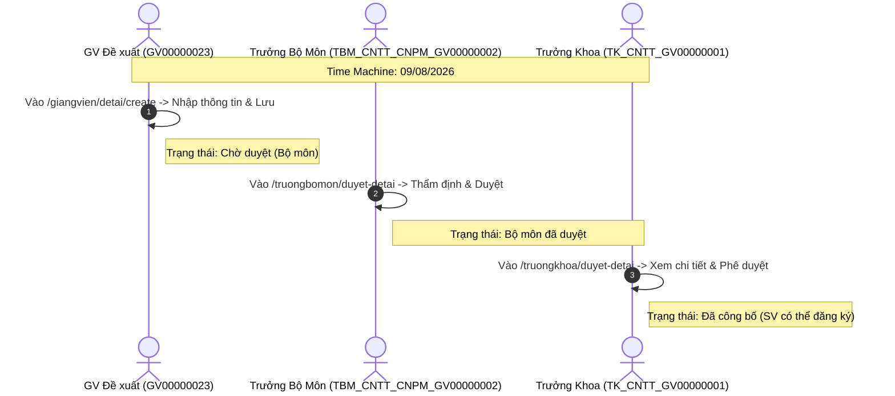
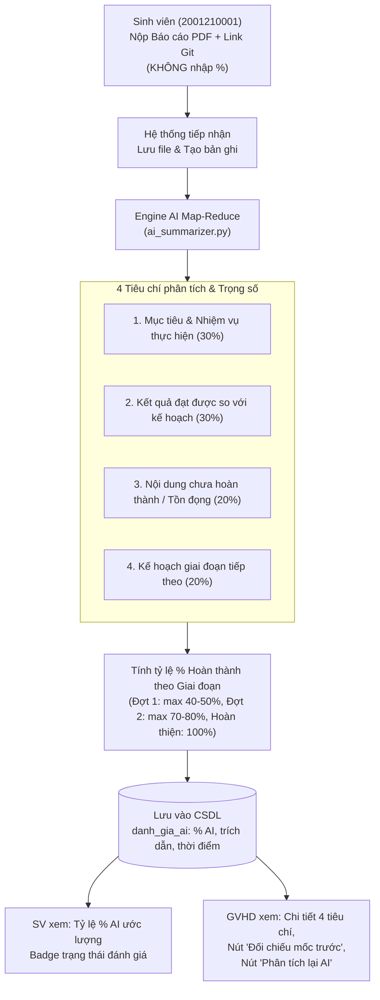

# 🧪 HƯỚNG DẪN KIỂM THỬ TOÀN DIỆN CÁC LUỒNG HOẠT ĐỘNG TRÊN WEBSITE
## HỆ THỐNG QUẢN LÝ CÔNG TÁC KHÓA LUẬN TỐT NGHIỆP — HUIT

> **Tài liệu hướng dẫn User Acceptance Testing (UAT) & End-to-End (E2E) Testing trực tiếp trên giao diện Web.**  
> Tài liệu này mô tả chi tiết từng bước thao tác, tài khoản thực hiện, đường dẫn URL, mốc thời gian giả lập (Time Machine) và kết quả kỳ vọng cho toàn bộ 10 luồng nghiệp vụ của hệ thống.

---

## 📋 MỤC LỤC CÁC KỊCH BẢN KIỂM THỬ

1. [Chuẩn bị môi trường & Thiết lập ban đầu](#1-chuẩn-bị-môi-trường--thiết-lập-ban-đầu)
2. [Bảng tài khoản thử nghiệm theo vai trò](#2-bảng-tài-khoản-thử-nghiệm-theo-vai-trò)
3. [Hướng dẫn sử dụng công cụ Time Machine](#3-hướng-dẫn-sử-dụng-công-cụ-time-machine)
4. [Luồng 1: Đề xuất & Phê duyệt Đề tài (3 Cấp xét duyệt)](#luồng-1-đề-xuất--phê-duyệt-đề-tài-3-cấp-xét-duyệt)
5. [Luồng 2: Thành lập Nhóm & Đăng ký Đề tài Khóa Luận](#luồng-2-thành-lập-nhóm--đăng-ký-đề-tài-khóa-luận)
6. [Luồng 3: Nộp Đề cương chi tiết & Phân công Giảng viên Phản biện](#luồng-3-nộp-đề-cương-chi-tiết--phân-công-giảng-viên-phản-biện)
7. [Luồng 4: Đặt lịch hẹn Hướng dẫn trực tiếp / Trực tuyến](#luồng-4-đặt-lịch-hẹn-hướng-dẫn-trực-tiếp--trực-tuyến)
8. [Luồng 5: Nộp Báo cáo Tiến độ & Đánh giá Tự động Bằng AI Map-Reduce (Bỏ nhập %)](#luồng-5-nộp-báo-cáo-tiến-độ--đánh-giá-tự-động-bằng-ai-map-reduce)
9. [Luồng 6: Thành lập Hội đồng Bảo vệ & Bộ lọc Đề tài chuẩn theo Ngành](#luồng-6-thành-lập-hội-đồng-bảo-vệ--bộ-lọc-đề-tài-chuẩn-theo-ngành)
10. [Luồng 7: Thư ký Chuẩn bị Phiếu Chấm & Chặn Quyền Tạo Phiếu của Chủ tịch](#luồng-7-thư-ký-chuẩn-bị-phiếu-chấm--chặn-quyền-tạo-phiếu-của-chủ-tịch)
11. [Luồng 8: Chấm Điểm Hội Đồng, Loại Bỏ Canvas Chữ Ký & Xuất PDF Chuẩn In](#luồng-8-chấm-điểm-hội-đồng-loại-bỏ-canvas-chữ-ký--xuất-pdf-chuẩn-in)
12. [Luồng 9: Tra Cứu Hội Đồng Bảo Vệ Riêng Biệt Cho Giảng Viên & Sinh Viên](#luồng-9-tra-cứu-hội-đồng-bảo-vệ-riêng-biệt-cho-giảng-viên--sinh-viên)
13. [Luồng 10: Nộp Lại Báo Cáo Hoàn Thiện Sau Bảo Vệ & Công Bố Lưu Trữ](#luồng-10-nộp-lại-báo-cáo-hoàn-thiện-sau-bảo-vệ--công-bố-lưu-trữ)
14. [Kiểm thử tự động hóa bằng Script xác minh](#14-kiểm-thử-tự-động-hóa-bằng-script-xác-minh)

---

## 1. CHUẨN BỊ MÔI TRƯỜNG & THIẾT LẬP BAN ĐẦU

### 1.1. Khởi động Web Server & Cơ sở dữ liệu
1. Đảm bảo dịch vụ MySQL đang chạy (qua XAMPP hoặc Laragon trên cổng `3306`).
2. Khởi động máy chủ Laravel:
   ```bash
   php artisan serve
   ```
3. Truy cập hệ thống tại: **`http://127.0.0.1:8000`**

### 1.2. Đảm bảo dữ liệu mẫu sẵn sàng
Nếu cơ sở dữ liệu chưa có dữ liệu, chạy lệnh nạp dữ liệu mẫu:
```bash
php scripts/export_all_sample_imports.php
```

---

## 2. BẢNG TÀI KHOẢN THỬ NGHIỆM THEO VAI TRÒ

> **Mật khẩu dùng chung cho tất cả tài khoản**: **`Huit@2026`** (hoặc `123456` nếu tài khoản khởi tạo ban đầu).

| Vai Trò Nghiệp Vụ | Tên Đăng Nhập | Họ và Tên | Đơn vị / Chức danh | Nhiệm vụ chính trong kiểm thử |
|---|---|---|---|---|
| **Giáo vụ / Quản trị** | `admin` | Ban Quản Trị Hệ Thống | Phòng Đào Tạo / Giáo Vụ | Quản lý kế hoạch, rà soát SV đủ điều kiện, giám sát tiến độ |
| **Trưởng Khoa** | `TK_CNTT_GV00000001` | PGS.TS. Nguyễn Văn Hùng | Trưởng Khoa CNTT | Duyệt đề tài cấp Khoa, Lập Hội đồng, Công bố kết quả |
| **Trưởng Bộ Môn CNPM** | `TBM_CNTT_CNPM_GV00000002` | TS. Trần Anh Dũng | Trưởng Bộ Môn CNPM | Duyệt đề tài BM, Phân công phản biện đề cương |
| **Giảng Viên Hướng Dẫn** | `GV00000023` | TS. Lê Hoàng Cường | Bộ Môn CNPM | Đề xuất đề tài, duyệt nhóm, nộp đề cương, đánh giá tiến độ |
| **Giảng Viên Phản Biện / Thư Ký HĐ** | `GV00000021` | ThS. Đặng Hải Giang | Bộ Môn CNPM | Phản biện đề cương, Thư ký chuẩn bị phiếu chấm, Chấm điểm HĐ |
| **Sinh Viên (Trưởng nhóm N01)** | `2001210001` | Nguyễn Hoàng Long | Lớp 12DHCNTT01 | Tạo nhóm, đăng ký đề tài, nộp báo cáo tiến độ, nộp hoàn thiện |
| **Sinh Viên (Thành viên N01)** | `2001210002` | Trần Minh Quân | Lớp 12DHCNTT01 | Nhận lời mời nhóm, cùng theo dõi tiến độ và hội đồng |
| **Sinh Viên (Thành viên N01)** | `2001210003` | Lê Phương Anh | Lớp 12DHCNTT01 | Thành viên nhóm N01 |
| **Sinh Viên (CNPM mới)**       | `2001210076` | Nguyễn Đức Duy | Lớp 12DHKPM01 | Ngành Kỹ thuật Phần mềm (BM CNPM) |
| **Sinh Viên (CNPM mới)**       | `2001210077` | Trần Thị Thu Trang | Lớp 12DHKPM01 | Ngành Kỹ thuật Phần mềm (BM CNPM) |
| **Sinh Viên (CNPM mới)**       | `2001210078` | Phạm Minh Triết | Lớp 12DHKPM01 | Ngành Kỹ thuật Phần mềm (BM CNPM) |
| **Sinh Viên (Test Luồng 1)**   | `2001210080` | Lê Hoàng Nam | Lớp 12DHKPM01 | Trưởng nhóm mới (Chưa có nhóm) |
| **Sinh Viên (Test Luồng 2)**   | `2001210081` | Nguyễn Mai Phương | Lớp 12DHKPM01 | Thành viên mới (Chưa có nhóm) |
| **Sinh Viên (Test Luồng 3)**   | `2001210082` | Vũ Tiến Đạt | Lớp 12DHKPM01 | Thành viên mới (Chưa có nhóm) |

---

## 3. HƯỚNG DẪN SỬ DỤNG CÔNG CỤ TIME MACHINE

Hệ thống tích hợp thanh công cụ **Time Machine** (nút nổi hình đồng hồ màu xanh dương ở góc dưới cùng bên phải tất cả các trang web).

- **Mục đích**: Thay đổi thời gian hệ thống ảo trong phiên làm việc (Session/Cookie) để kiểm thử các quy định về hạn chót mà không can thiệp đồng hồ thực của máy tính.
- **Cách sử dụng**:
  1. Nhấp vào biểu tượng **Time Machine** ở góc dưới cùng bên phải.
  2. Bấm chọn mốc được cấu hình sẵn hoặc nhập ngày giờ tùy ý:
     - `09/08/2026`: Mở cổng Đề xuất đề tài.
     - `10/08/2026 10:00`: Mở cổng Tạo nhóm & Đăng ký đề tài.
     - `11/08/2026 09:30`: Đóng cổng tạo nhóm, chuyển sang Nộp đề cương & Phân công phản biện.
     - `20/09/2026`: Hạn nộp Báo cáo tiến độ Đợt 1.
     - `15/10/2026`: Hạn nộp Báo cáo tiến độ Đợt 2.
     - `05/11/2026`: Giai đoạn Hội đồng bảo vệ khóa luận.
     - `20/11/2026`: Giai đoạn Nộp lại báo cáo hoàn thiện sau bảo vệ.
  3. Bấm nút **"Áp dụng"**: Trang web sẽ tải lại với thời gian ảo đã kích hoạt.
  4. Sau khi kiểm thử xong, bấm **"Khôi phục thời gian thực"** để quay về bình thường.

---

## LUỒNG 1: ĐỀ XUẤT & PHÊ DUYỆT ĐỀ TÀI (3 CẤP XÉT DUYỆT)

### Mục tiêu kiểm thử:
Kiểm tra quy trình khép kín: Giảng viên đề xuất đề tài -> Trưởng bộ môn thẩm định -> Trưởng khoa phê duyệt & công bố công khai cho sinh viên.



### Các bước thực hiện trên Website:

#### Bước 1.1: Giảng viên gửi đề xuất đề tài
1. Kích hoạt Time Machine: chọn ngày **`09/08/2026`**.
2. Đăng nhập tài khoản Giảng viên: `GV00000023` / `Huit@2026`.
3. Truy cập menu: **Quản lý Đề tài** (`/giangvien/detai`) -> Nhấn **Thêm mới Đề tài** (`/giangvien/detai/create`).
4. Điền các trường thông tin:
   - **Tên đề tài**: *Ứng dụng Trí tuệ nhân tạo trong Nhận diện Bất thường Giao dịch*
   - **Học phần**: Chọn `Khóa luận tốt nghiệp - CNPM (HP_KLTN_CNPM)`
   - **Bộ môn**: `Công nghệ phần mềm`
   - **Mục tiêu, Yêu cầu, Sản phẩm dự kiến**: Điền nội dung mẫu.
5. Nhấn **Gửi phê duyệt**.
6. **Kết quả kỳ vọng**: Đề tài được lưu thành công, trạng thái hiển thị là badge màu vàng **"Chờ duyệt (Bộ môn)"**.

#### Bước 1.2: Trưởng bộ môn phê duyệt cấp chuyên môn
1. Đăng xuất, đăng nhập tài khoản Trưởng Bộ Môn CNPM: `TBM_CNTT_CNPM_GV00000002` / `Huit@2026`.
2. Truy cập menu: **Phê duyệt Đề tài** (`/truongbomon/duyet-detai`).
3. Tìm đề tài vừa đề xuất ở Bước 1.1 -> Nhấn **Xem chi tiết**.
4. Nhập nhận xét chuyên môn và nhấn nút **Phê duyệt** (màu xanh lá).
5. **Kết quả kỳ vọng**: Trạng thái đề tài cập nhật thành **"Bộ môn đã duyệt"**; thông báo đẩy gửi về cho Giảng viên.

#### Bước 1.3: Trưởng khoa phê duyệt & Công bố chính thức
1. Đăng xuất, đăng nhập tài khoản Trưởng Khoa: `TK_CNTT_GV00000001` / `Huit@2026`.
2. Truy cập menu: **Duyệt Đề tài** (`/truongkhoa/duyet-detai`).
3. Chọn đề tài từ danh sách -> Nhấn nút **Phê duyệt & Công bố**.
4. **Kết quả kỳ vọng**: Đề tài chuyển sang trạng thái **"Đã công bố"** (Published), sẵn sàng để sinh viên đăng ký.

---

## LUỒNG 2: THÀNH LẬP NHÓM & ĐĂNG KÝ ĐỀ TÀI KHÓA LUẬN

### Mục tiêu kiểm thử:
Kiểm tra điều kiện thành lập nhóm (sinh viên phải đủ điều kiện, cùng học phần & bộ môn), gửi lời mời thành viên, đăng ký đề tài và giảng viên hướng dẫn chấp thuận.

### Các bước thực hiện trên Website:

#### Bước 2.1: Sinh viên Trưởng nhóm khởi tạo nhóm & Mời bạn
1. Kích hoạt Time Machine: chọn ngày **`10/08/2026 10:00`**.
2. Đăng nhập Sinh viên Trưởng nhóm: `2001210001` / `Huit@2026`.
3. Truy cập menu: **Nhóm của tôi** (`/sinhvien/nhom`).
4. Nhập tên nhóm (VD: *Nhóm Nghiên Cứu AI KLTN*) và chọn Học phần: `HP_KLTN_CNPM` -> Bấm **Tạo nhóm**.
5. Sau khi tạo nhóm, tại ô tìm kiếm MSSV, nhập `2001210002` -> Bấm **Gửi lời mời**.
6. Tiếp tục nhập `2001210003` -> Bấm **Gửi lời mời**.
7. **Kết quả kỳ vọng**: Trạng thái lời mời hiển thị là "Đang chờ xác nhận".

#### Bước 2.2: Sinh viên thành viên chấp nhận lời mời
1. Đăng nhập tài khoản thành viên: `2001210002` / `Huit@2026`.
2. Vào menu **Nhóm của tôi** (`/sinhvien/nhom`) -> Khu vực **Lời mời tham gia nhóm**.
3. Nhấn nút **Chấp nhận**.
4. Làm tương tự cho sinh viên `2001210003`.
5. **Kết quả kỳ vọng**: Cả 3 sinh viên đều nằm trong danh sách thành viên chính thức của nhóm.

#### Bước 2.3: Đăng ký Đề tài đã công bố
1. Quay lại tài khoản Trưởng nhóm: `2001210001`.
2. Vào menu: **Đăng ký Đề tài** (`/sinhvien/dangky`).
3. Tìm kiếm đề tài thuộc bộ môn CNPM (VD: Đề tài của TS. Lê Hoàng Cường).
4. Nhấn nút **Đăng ký đề tài này** -> Xác nhận trong modal popup.
5. **Kết quả kỳ vọng**: Đề tài chuyển sang trạng thái "Chờ GVHD xác nhận". Các nhóm khác không thể đăng ký trùng.

#### Bước 2.4: Giảng viên hướng dẫn duyệt nhóm đăng ký
1. Đăng nhập GVHD: `GV00000023` / `Huit@2026`.
2. Vào menu: **Duyệt đăng ký đề tài** (`/giangvien/duyet-dangky-detai`).
3. Kiểm tra danh sách thành viên nhóm đăng ký -> Nhấn **Đồng ý hướng dẫn**.
4. **Kết quả kỳ vọng**: Nhóm chính thức được liên kết với đề tài; chỉ tiêu hướng dẫn của giảng viên tăng thêm 1.

---

## LUỒNG 3: NỘP ĐỀ CƯƠNG CHI TIẾT & PHÂN CÔNG GIẢNG VIÊN PHẢN BIỆN

### Mục tiêu kiểm thử:
Kiểm tra quá trình nộp đề cương file PDF/Word, Trưởng bộ môn phân công phản biện dựa trên chỉ tiêu tải trọng, và Giảng viên phản biện đánh giá trên trình xem PDF.js nhúng.

### Các bước thực hiện trên Website:

#### Bước 3.1: GVHD nộp Đề cương chi tiết
1. Kích hoạt Time Machine: chọn ngày **`11/08/2026 09:30`**.
2. Đăng nhập GVHD: `GV00000023` / `Huit@2026`.
3. Vào menu **Quản lý Đề tài** (`/giangvien/detai`) -> Nhấn **Nộp đề cương** tại đề tài của nhóm N01.
4. Chọn tệp PDF hoặc Word (`.docx`) từ máy tính -> Bấm **Tải lên & Nộp đề cương**.
5. **Kết quả kỳ vọng**: Trạng thái đề cương chuyển sang "Đã nộp, chờ phân công phản biện".

#### Bước 3.2: Trưởng bộ môn phân công Giảng viên phản biện
1. Đăng nhập TBM CNPM: `TBM_CNTT_CNPM_GV00000002` / `Huit@2026`.
2. Vào menu: **Phân công Phản biện** (`/truongbomon/phan-cong-phan-bien`).
3. Quan sát bảng chỉ tiêu phản biện: Mỗi giảng viên có cột *Đã phân công / Tối đa* (trực quan theo màu sắc).
4. Chọn đề tài cần phân công -> Chọn Giảng viên phản biện: `GV00000021` (ThS. Đặng Hải Giang) -> Nhấn **Lưu phân công**.
5. **Kết quả kỳ vọng**: GVPB nhận được thông báo; chỉ tiêu của GV00000021 tăng 1.

#### Bước 3.3: Giảng viên phản biện đánh giá đề cương qua PDF.js
1. Đăng nhập GVPB: `GV00000021` / `Huit@2026`.
2. Vào menu: **Phản biện Đề cương** (`/giangvien/phan-bien-de-cuong`).
3. Nhấn nút **Xem nhanh đề cương**: Modal hiện lên sử dụng **Mozilla PDF.js**, hiển thị các trang tài liệu mượt mà, hỗ trợ zoom và xoay trang.
4. Nhập nhận xét phản biện vào ô ghi chú.
5. Chọn kết luận: **Đạt** -> Nhấn **Lưu kết quả phản biện**.
6. **Kết quả kỳ vọng**: Kết quả phản biện ghi nhận "Đạt", đề cương chuyển sang bước duyệt cuối của TBM.

---

## LUỒNG 4: ĐẶT LỊCH HẸN HƯỚNG DẪN TRỰC TIẾP / TRỰC TUYẾN

### Mục tiêu kiểm thử:
Giảng viên mở khung giờ tư vấn/hướng dẫn đồ án; Sinh viên đăng ký lịch gặp để trao đổi học thuật.

### Các bước thực hiện trên Website:
1. Đăng nhập GVHD `GV00000023` -> Vào trang Lịch làm việc / Hướng dẫn.
2. Nhấn **Tạo khung giờ hẹn mới**:
   - Ngày gặp: Ngày kế tiếp.
   - Giờ: `09:00 - 10:30`.
   - Hình thức: Trực tiếp tại Văn phòng Bộ môn CNPM (hoặc link Google Meet).
   - Nhấn **Lưu khung giờ**.
3. Đăng xuất, Đăng nhập Sinh viên `2001210001`.
4. Vào chức năng **Lịch hẹn hướng dẫn** -> Thấy khung giờ GV vừa mở.
5. Nhập ghi chú: *"Nhóm xin trao đổi về thiết kế lược đồ cơ sở dữ liệu và API"* -> Bấm **Đăng ký hẹn**.
6. GVHD kiểm tra danh sách đăng ký và bấm **Xác nhận lịch**.

---

## LUỒNG 5: NỘP BÁO CÁO TIẾN ĐỘ & ĐÁNH GIÁ TỰ ĐỘNG BẰNG AI MAP-REDUCE

> [!IMPORTANT]
> **Yêu cầu then chốt đã hoàn thiện**:
> 1. Form nộp báo cáo của Sinh viên **KHÔNG CÒN** ô tự nhập tỷ lệ % hoàn thành.
> 2. AI tự động đọc nội dung văn bản, phân tích theo 4 tiêu chí có trọng số giai đoạn, tự tính % và lưu vào CSDL.
> 3. Tuyệt đối không tự ý gán 0% hoặc 100% khi tệp lỗi.
> 4. GVHD có chức năng **Đối chiếu mốc trước** và **Phân tích lại AI**.



### Các bước thực hiện trên Website:

#### Bước 5.1: Sinh viên nộp báo cáo (Kiểm tra giao diện bỏ trường %)
1. Kích hoạt Time Machine: chọn ngày **`20/09/2026`** (Mốc Báo cáo Đợt 1).
2. Đăng nhập Sinh viên: `2001210001` / `Huit@2026`.
3. Vào menu: **Báo cáo Tiến độ** (`/sinhvien/baocao`).
4. Nhấn **Nộp báo cáo** cho Đợt 1:
   - **Quan sát kỹ Form**: Xác nhận không còn trường `Tỷ lệ hoàn thành (%)` để sinh viên tự gõ số.
   - Nhập nội dung thực hiện: *"Đã hoàn thành khảo sát thực trạng, đặc tả 15 use cases chính và thiết kế kiến trúc hệ thống 3 lớp."*
   - Kế hoạch tiếp theo: *"Hiện thực hóa các module xác thực và thiết kế RESTful API."*
   - Đính kèm tệp PDF báo cáo hoặc nhập liên kết Repository GitHub.
5. Nhấn **Nộp Báo Cáo**.
6. **Kết quả kỳ vọng**:
   - Báo cáo được gửi thành công.
   - Hệ thống chạy phân tích AI ngầm.
   - Trên bảng tiến độ của SV hiển thị badge **Tỷ lệ AI ước tính** (kèm thời gian đánh giá).

#### Bước 5.2: Giảng viên hướng dẫn xem đối chiếu AI & Duyệt tiến độ
1. Đăng nhập GVHD: `GV00000023` / `Huit@2026`.
2. Vào menu: **Báo cáo Tiến độ** (`/giangvien/baocao`) -> Nhấn **Xem chi tiết báo cáo**.
3. Tại khu vực **"Kết quả đánh giá AI (Map-Reduce Engine)"**:
   - Thấy tỷ lệ % hoàn thành do AI tính toán (Ví dụ: `38%` cho Đợt 1).
   - Xem 4 tiêu chí chi tiết kèm trích dẫn văn bản trực tiếp từ tệp nộp.
   - Nếu sinh viên vừa cập nhật file mới, nhấn nút **"Phân tích lại bằng AI"** (`POST /bao-cao-ai/{id}/phan-tich-lai`) để hệ thống tính lại.
   - Nhấn nút **"Đối chiếu mốc trước"**: Modal mở ra bảng so sánh chi tiết giữa Đợt 1 và Đợt 2 (đối với các đợt sau) xem nhóm đã giải quyết các tồn đọng của đợt trước hay chưa.
4. GVHD nhập nhận xét sư phạm và nhấn **Xác nhận Đạt tiến độ đợt 1**.

---

## LUỒNG 6: THÀNH LẬP HỘI ĐỒNG BẢO VỆ & BỘ LỌC ĐỀ TÀI CHUẨN THEO NGÀNH

> [!IMPORTANT]
> **Yêu cầu then chốt đã hoàn thiện**:
> - Khắc phục lỗi trộn lẫn Ngành: Dropdown phân cấp Khoa -> Bộ môn -> Ngành hoạt động chuẩn xác.
> - Danh sách nhóm đề tài hiển thị đúng theo mã ngành (`maNganh`), không dùng tên văn bản tùy ý.
> - Thuật toán gợi ý AI thành viên hội đồng tự động loại trừ GVHD và ngăn ngừa trùng lịch bảo vệ.

### Các bước thực hiện trên Website:

#### Bước 6.1: Trưởng khoa tạo Hội đồng mới với Bộ lọc Cascade chuẩn
1. Kích hoạt Time Machine: chọn ngày **`05/11/2026`**.
2. Đăng nhập Trưởng Khoa: `TK_CNTT_GV00000001` / `Huit@2026`.
3. Vào menu: **Hội đồng Bảo vệ** (`/truongkhoa/hoidong`) -> Nhấn **Tạo Hội đồng mới** (`/truongkhoa/hoidong/create`).
4. Nhập thông tin hội đồng:
   - **Tên Hội đồng**: *Hội đồng Bảo vệ KLTN KTPM - Hội trường A*
   - **Ngày bảo vệ**: `10/11/2026` | **Khung giờ**: `08:00 - 11:30`
   - **Phòng thi**: `A.405`
5. **Kiểm tra bộ lọc phân cấp**:
   - Chọn Khoa: `Khoa Công nghệ Thông tin (CNTT)`.
   - Chọn Bộ môn: `Công nghệ phần mềm (CNPM)`.
   - Chọn Ngành: `Kỹ thuật phần mềm (7480103)` hoặc `Công nghệ thông tin (7480201)`.
   - **Xác nhận**: Danh sách đề tài tải về qua AJAX chỉ hiển thị các nhóm thuộc đúng mã Ngành được chọn, không xuất hiện các nhóm của ngành khác!

#### Bước 6.2: Sử dụng AI Gợi ý Thành viên & Phân công
1. Nhấn nút **"Gợi ý thành viên bằng AI"** (`/truongkhoa/hoidong/de-xuat-thanh-vien`):
   - Thuật toán tự động đề xuất: Chủ tịch, Thư ký, Ủy viên 1, Ủy viên 2.
   - **Kiểm tra nghiệp vụ bảo vệ**: Giảng viên hướng dẫn `GV00000023` của nhóm bảo vệ tuyệt đối **KHÔNG** bị xếp làm Chủ tịch hoặc chấm chính nhóm mình.
   - Giảng viên bị trùng khung giờ tại hội đồng khác sẽ được gắn cờ cảnh báo đỏ.
2. Chọn Thư ký Hội đồng: `GV00000021` (ThS. Đặng Hải Giang).
3. Nhấn nút **Lưu Hội đồng**.

#### Bước 6.3: Phân công nhóm & Công bố Hội đồng
1. Tại màn hình chi tiết Hội đồng, gán Nhóm N01 vào Hội đồng.
2. Nhấn nút **Công bố Hội đồng** (`POST /truongkhoa/hoidong/{id}/cong-bo`).
3. **Kết quả kỳ vọng**: Trạng thái hội đồng chuyển sang "Đã công bố"; sinh viên và giảng viên bắt đầu tra cứu được lịch thi.

---

## LUỒNG 7: THƯ KÝ CHUẨN BỊ PHIẾU CHẤM & CHẶN QUYỀN TẠO PHIẾU CỦA CHỦ TỊCH

> [!IMPORTANT]
> **Quy định phân quyền cốt lõi**:
> - **Thư ký Hội đồng**: Được xem đề cương chi tiết (dạng **Read-only** chống sửa đổi), được bấm nút **Chuẩn bị phiếu chấm**, xuất PDF mẫu phiếu chấm.
> - **Chủ tịch Hội đồng & Thành viên khác**: Không có quyền chuẩn bị phiếu chấm. Nếu cố tình truy cập link tạo phiếu sẽ nhận phản hồi **HTTP 403 Forbidden**.

### Các bước thực hiện trên Website:

#### Bước 7.1: Thư ký xem đề cương Read-Only
1. Đăng nhập tài khoản Thư ký: `GV00000021` / `Huit@2026`.
2. Vào menu: **Chấm điểm Hội đồng** (`/giangvien/chamdiem`).
3. Tại dòng đề tài nhóm N01, nhấn nút **"Xem Đề cương"** (`/giangvien/chamdiem/de-cuong/{maHoSo}`).
4. **Kiểm tra giao diện**:
   - Giao diện hiển thị đầy đủ thông tin đề cương: Mục tiêu, Phạm vi, Nội dung thực hiện, Sản phẩm dự kiến, Phiên bản đề cương đã được phê duyệt.
   - Toàn bộ là dạng văn bản tĩnh hoặc bản PDF, **hoàn toàn không có nút chỉnh sửa hay lưu đè**.

#### Bước 7.2: Thư ký chuẩn bị Phiếu chấm
1. Quay lại trang chấm điểm, nhấn nút **"Chuẩn bị phiếu chấm"** (`POST /giangvien/chamdiem/chuan-bi-phieu`).
2. Hệ thống kiểm tra: Nếu phiếu chưa có, tạo mới cấu trúc phiếu chấm theo 4 tiêu chí chuẩn của Khoa; nếu đã có, hiển thị thông báo đã sẵn sàng (chống trùng lặp).
3. **Kết quả kỳ vọng**: Badge trạng thái chuyển sang **"Phiếu chấm đã sẵn sàng"**.

#### Bước 7.3: Kiểm tra bảo mật — Chặn quyền Chủ tịch tạo phiếu (Security Verification)
1. Đăng xuất, đăng nhập tài khoản Giảng viên là Chủ tịch Hội đồng (không phải Thư ký).
2. Vào trang **Chấm điểm Hội đồng** (`/giangvien/chamdiem`):
   - Nút "Chuẩn bị phiếu chấm" **đã bị ẩn hoàn toàn** khỏi giao diện.
3. Kiểm tra bảo mật cấp Server: Thử gửi request thủ công qua Postman hoặc Console browser:
   ```javascript
   fetch('/giangvien/chamdiem/chuan-bi-phieu', {
       method: 'POST',
       headers: {'X-CSRF-TOKEN': document.querySelector('meta[name="csrf-token"]').content, 'Content-Type': 'application/json'},
       body: JSON.stringify({ maHoSo: 1 })
   }).then(r => console.log('HTTP Status:', r.status));
   ```
4. **Kết quả kỳ vọng**: Server chặn ngay lập tức và trả về mã lỗi **`403 Forbidden`** (Hoặc redirect kèm thông báo *"Chỉ Thư ký Hội đồng mới có quyền chuẩn bị phiếu chấm"*).

---

## LUỒNG 8: CHẤM ĐIỂM HỘI ĐỒNG, LOẠI BỎ CANVAS CHỮ KÝ & XUẤT PDF CHUẨN IN

### Mục tiêu kiểm thử:
Các thành viên Hội đồng nhập điểm theo thang đo 4 tiêu chí; xác nhận hoàn toàn không còn vùng chữ ký cảm ứng vẽ tay trên giao diện web; xuất phiếu điểm PDF định dạng chuẩn in ấn A4.

### Các bước thực hiện trên Website:

#### Bước 8.1: Nhập điểm thành viên Hội đồng
1. Đăng nhập Giảng viên thành viên Hội đồng `GV00000021`.
2. Vào menu **Chấm điểm Hội đồng** (`/giangvien/chamdiem`).
3. Nhập điểm chi tiết cho từng sinh viên trong nhóm theo 4 tiêu chí:
   - *Tiêu chí 1: Tổng quan & Cơ sở lý thuyết* (Tối đa 2.0đ)
   - *Tiêu chí 2: Phương pháp & Hiện thực hệ thống* (Tối đa 3.0đ)
   - *Tiêu chí 3: Kết quả thực nghiệm & Ứng dụng* (Tối đa 3.0đ)
   - *Tiêu chí 4: Kỹ năng thuyết trình & Trả lời câu hỏi* (Tối đa 2.0đ)
4. Nhập nhận xét đánh giá tổng quát.
5. **Kiểm tra loại bỏ Canvas chữ ký**:
   - Cuộn xuống cuối form chấm điểm: Không còn thẻ `<canvas id="signature-pad">`, không có nút "Ký tên" hay "Xóa chữ ký".
6. Nhấn nút **Lưu điểm & Khóa phiếu**.

#### Bước 8.2: Xuất PDF Phiếu chấm & Biên bản bảo vệ
1. Nhấn nút **"Xuất PDF Phiếu Chấm"** (`/giangvien/chamdiem/xuat-pdf?maHoSo=...`).
2. Trình duyệt tải về tệp PDF:
   - Tiêu đề: *PHIẾU ĐÁNH GIÁ KHÓA LUẬN TỐT NGHIỆP*.
   - Đầy đủ thông tin: Trường, Khoa, Tên đề tài, Nhóm sinh viên, Học kỳ.
   - Bảng điểm chi tiết 4 tiêu chí cùng điểm tổng kết hệ số 10.
   - Phần chân trang có nơi ghi rõ: *Họ tên Giảng viên chấm*, ngày tháng lập phiếu, kèm vị trí ký và ghi rõ họ tên trên bản in giấy vật lý chuẩn hành chính đại học.

---

## LUỒNG 9: TRA CỨU HỘI ĐỒNG BẢO VỆ RIÊNG BIỆT CHO GIẢNG VIÊN & SINH VIÊN

### Mục tiêu kiểm thử:
Đảm bảo cả Giảng viên và Sinh viên đều có trang chuyên biệt để theo dõi thông tin hội đồng; ngăn chặn lỗi bảo mật truy cập chéo dữ liệu (IDOR).

### Các bước thực hiện trên Website:

#### Bước 9.1: Giảng viên tra cứu trang "Hội đồng của tôi"
1. Đăng nhập Giảng viên: `GV00000021` / `Huit@2026`.
2. Nhấp menu: **Hội đồng của tôi** (`/giangvien/hoi-dong`).
3. **Kiểm tra các tính năng**:
   - Bộ lọc: Lọc theo Học kỳ, theo Vai trò trong Hội đồng (Chủ tịch, Thư ký, Ủy viên) và Trạng thái.
   - Thống kê tổng số hội đồng tham gia.
   - Nhấn **Chi tiết Hội đồng** (`/giangvien/hoi-dong/{id}`): Xem danh sách các đề tài báo cáo, giờ báo cáo từng nhóm, phòng bảo vệ và danh sách thành viên hội đồng.

#### Bước 9.2: Sinh viên tra cứu trang "Hội đồng bảo vệ"
1. Đăng nhập Sinh viên: `2001210001` / `Huit@2026`.
2. Nhấp menu: **Hội đồng bảo vệ** (`/sinhvien/hoi-dong`).
3. **Kiểm tra giao diện**:
   - Thẻ thông tin phòng thi: Tên Hội đồng, Ngày bảo vệ, Ca bảo vệ, Số phòng thi.
   - Danh sách Hội đồng: Hiển thị chức danh & họ tên Chủ tịch, Thư ký, Ủy viên.
   - Thứ tự báo cáo của nhóm trong ca thi.
   - Hướng dẫn chuẩn bị bảo vệ: Quy định về trang phục tác phong, nộp slide thuyết trình trước giờ G, thời lượng trình bày tối đa (15-20 phút).
4. **Kiểm tra an toàn dữ liệu (IDOR)**:
   - Sinh viên thuộc nhóm chưa được xếp hội đồng khi truy cập vào sẽ thấy thông báo: *"Đề tài của bạn hiện chưa được phân công Hội đồng bảo vệ hoặc Hội đồng chưa được công bố"*. Không bao giờ hiển thị nhầm dữ liệu của nhóm khác.

---

## LUỒNG 10: NỘP LẠI BÁO CÁO HOÀN THIỆN SAU BẢO VỆ & CÔNG BỐ LƯU TRỮ

> [!IMPORTANT]
> **Quy trình hoàn tất khóa luận**:
> 1. Sinh viên tiếp thu ý kiến hội đồng -> Nộp lại Báo cáo hoàn chỉnh + Bảng giải trình chỉnh sửa + Tệp minh chứng.
> 2. Giảng viên hướng dẫn kiểm tra & xác nhận Đạt yêu cầu.
> 3. Trưởng khoa phê duyệt công bố & chuyển vào kho lưu trữ số.

### Các bước thực hiện trên Website:

#### Bước 10.1: Sinh viên nộp báo cáo hoàn thiện & Bảng giải trình
1. Kích hoạt Time Machine: chọn ngày **`20/11/2026`** (Sau đợt bảo vệ).
2. Đăng nhập Sinh viên Trưởng nhóm: `2001210001` / `Huit@2026`.
3. Vào menu: **Kết quả** -> Nhấn nút **Hoàn thiện Báo cáo sau bảo vệ** (`/sinhvien/ket-qua/hoan-thien-bao-cao`).
4. Tải lên 3 mục bắt buộc:
   - **Tệp báo cáo PDF hoàn chỉnh** (đã chỉnh sửa theo góp ý của Hội đồng).
   - **Bảng giải trình chi tiết** (File Word/PDF hoặc nhập nội dung giải trình từng ý kiến của Chủ tịch/Phản biện).
   - **Tệp mã nguồn / Minh chứng** (Link Google Drive / GitHub hoặc file nén `.zip`).
5. Nhấn **Gửi Báo Cáo Hoàn Thiện**.
6. **Kết quả kỳ vọng**: Trạng thái hiển thị là "Đã nộp bản hoàn thiện - Chờ GVHD xác nhận".

#### Bước 10.2: Giảng viên hướng dẫn kiểm tra và xác nhận Đạt
1. Đăng nhập GVHD: `GV00000023` / `Huit@2026`.
2. Vào menu: **Kiểm tra Báo cáo sau bảo vệ** (`/giangvien/kiem-tra-bao-cao-sau-bao-ve`).
3. Mở bản xem Báo cáo hoàn thiện và bảng giải trình của nhóm N01.
4. Đánh giá: Chọn **Đạt yêu cầu chỉnh sửa** -> Nhập nhận xét xác nhận -> Nhấn **Phê duyệt hoàn tất**.
5. **Kết quả kỳ vọng**: Đề tài được đóng dấu xác nhận hoàn tất nội dung chuyên môn.

#### Bước 10.3: Trưởng khoa công bố kết quả và chuyển kho lưu trữ
1. Đăng nhập Trưởng Khoa: `TK_CNTT_GV00000001` / `Huit@2026`.
2. Vào menu: **Kết quả Khóa luận** (`/truongkhoa/ket-qua`).
3. Kiểm tra danh sách các đề tài đã hoàn tất phê duyệt báo cáo sau bảo vệ.
4. Nhấn nút **Công bố Kết quả & Chuyển Lưu Trữ** (`POST /truongkhoa/ket-qua/cong-bo`).
5. Nhấn **Xuất Bảng Điểm Tổng Hợp** (`/truongkhoa/ket-qua/export`): Hệ thống xuất tệp Excel danh sách điểm tổng kết của toàn bộ sinh viên tốt nghiệp.

---

## 14. KIỂM THỬ TỰ ĐỘNG HÓA BẰNG SCRIPT XÁC MINH

Bên cạnh việc kiểm thử thủ công trên trình duyệt web, bạn có thể chạy toàn bộ kịch bản kiểm tra tự động gồm **14 tiêu chí kỹ thuật** (CSDL, Eloquent Model, Controller, AI Engine, Phân quyền, Policy và Routes):

```powershell
# Chạy script kiểm thử toàn diện
php scripts/verify_system.php
```

### Bảng kết quả kỳ vọng khi chạy script:
```text
========================================================================
KIEM TRA TOAN DIEN HE THONG QUAN LY KHOA LUAN TOT NGHIEP (HUIT)
========================================================================
[PASS]  1. CSDL: Cac cot danh gia AI trong bang `baocaotiendo`
[PASS]  2. CSDL: Bang `danh_gia_ai` ton tai va day du cac cot
[PASS]  3. AI Engine: Test file ai_summarizer.py voi du lieu mau
[PASS]  4. Model & Service: BaoCaoTienDo co quan he va tinh % AI
[PASS]  5. View Sinh Vien: Form nop bao cao da go bo nhap % thu cong
[PASS]  6. View Giang Vien: Co giao dien xem & doi chieu danh gia AI
[PASS]  7. CSDL: Quan he Khoa - BoMon - Nganh - GiangVien - SinhVien
[PASS]  8. Hoi Dong: Controller loc de tai theo dung ma Nganh (nganh_id)
[PASS]  9. Hoi Dong: View tao hoi dong co Cascade dropdown Bo Mon -> Nganh
[PASS] 10. Thu Ky Hoi Dong: Chuc nang tao phieu cham & xem de cuong
[PASS] 11. Chu Tich Hoi Dong: Da chan quyen tao phieu cham (403 Forbidden)
[PASS] 12. Chu Ky: Da go bo chu ky canvas va ho tro xuat PDF sach
[PASS] 13. Hoi Dong: Trang rieng cho Giang vien va Sinh vien
[PASS] 14. Bao Cao Sau Bao Ve: Sinh vien nop lai, GV kiem tra & Trưởng khoa luu tru
========================================================================
KET QUA: 14/14 TEST CASES PASS! HE THONG HOAT DONG CHUAN XAC.
========================================================================
```

---
*Tài liệu được cập nhật tự động — Bộ phận Đảm bảo Chất lượng Đào tạo Khoa CNTT — HUIT.*
