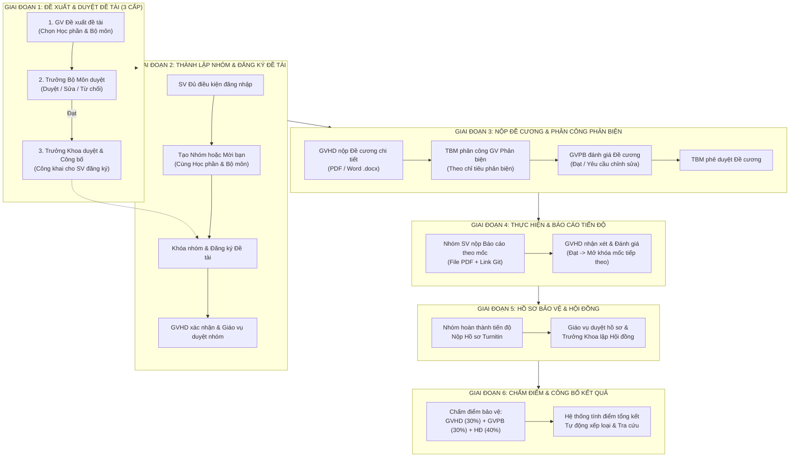

# 🎓 HỆ THỐNG QUẢN LÝ CÔNG TÁC KHÓA LUẬN TỐT NGHIỆP (HUIT)

> **TRƯỜNG ĐẠI HỌC CÔNG THƯƠNG TP. HỒ CHÍ MINH (HUIT)**  
> **Khoa Công Nghệ Thông Tin**  
> **Phiên bản**: 3.0 (Quy trình chuẩn hóa 5 cấp vai trò, 12 học phần khóa luận & Time Machine)  
> **Tech Stack**: Laravel 11.x | PHP 8.2+ | MySQL 8.x | Bootstrap 5 | Mozilla PDF.js | Mammoth.js | Chart.js | FullCalendar v6

---

## 📌 TỔNG QUAN HỆ THỐNG

Hệ thống **Quản lý Công tác Khóa luận Tốt nghiệp HUIT** là nền tảng quản trị và vận hành toàn diện quy trình khóa luận tốt nghiệp theo chuẩn đào tạo tín chỉ, phục vụ 5 phân quyền vai trò người dùng trong trường đại học:

1. **Giáo vụ Khoa / Quản trị viên (Admin)**: Quản lý danh mục nền (Khoa, Bộ môn, Ngành, Lớp, Học kỳ, Học phần), xét duyệt danh sách sinh viên đủ điều kiện, thiết lập mốc thời gian kế hoạch khóa luận, quản lý chỉ tiêu hướng dẫn/phản biện, quản trị tài khoản, nhập/xuất dữ liệu Excel/CSV và theo dõi Dashboard thống kê.
2. **Trưởng Khoa (Dean)**: Phê duyệt đề tài cấp Khoa, ra quyết định công bố đề tài cho sinh viên đăng ký, thành lập Hội đồng bảo vệ khóa luận và theo dõi báo cáo kết quả tổng kết toàn khoa.
3. **Trưởng Bộ Môn (Head of Department)**: Phê duyệt đề tài cấp Bộ môn (Duyệt/Yêu cầu chỉnh sửa/Từ chối), duyệt đề cương chi tiết, phân công giảng viên phản biện theo chỉ tiêu năng lượng của từng giảng viên trong bộ môn.
4. **Giảng viên (Lecturer / Supervisor / Reviewer)**: Đề xuất đề tài theo học phần khóa luận, nộp đề cương chi tiết, hướng dẫn nhóm sinh viên, đánh giá tiến độ các mốc báo cáo, chấm điểm phản biện và chấm điểm Hội đồng bảo vệ.
5. **Sinh viên (Student)**: Xem thông báo điều kiện khóa luận, khởi tạo nhóm (2-3 sinh viên cùng học phần & bộ môn), mời thành viên, đăng ký đề tài đã công bố, nộp báo cáo tiến độ các mốc (PDF/Git), nộp hồ sơ bảo vệ (Turnitin) và tra cứu kết quả điểm tổng kết.

---

## 🛠️ TECH STACK & CÔNG NGHỆ SỬ DỤNG

- **Backend**: [Laravel 11.x](https://laravel.com/) (PHP 8.2+ / 8.3)
- **Database**: MySQL 8.x / MariaDB (Bộ mã hóa `utf8mb4_unicode_ci`)
- **Frontend**: Blade Templating, Bootstrap 5.3, FontAwesome 6, Custom HUIT Theme (`#00529B`, `#004E64`)
- **Trình đọc tài liệu nhúng**:
  - **Mozilla PDF.js v3.11** (`pdf.min.js` & `pdf.worker.min.js`): Giải mã và hiển thị tệp PDF trực tiếp lên thẻ HTML5 Canvas (chống lỗi chặn iframe/CSP của Chrome).
  - **Mammoth.js**: Đọc và chuyển đổi tệp tài liệu Microsoft Word (`.docx`) sang HTML trực tiếp trên trình duyệt.
- **Xử lý Excel / CSV**: [PhpSpreadsheet](https://phpspreadsheet.readthedocs.io/) (Hỗ trợ định dạng XLSX và CSV UTF-8 BOM chuẩn dấu tiếng Việt trên Microsoft Excel).
- **Trực quan hóa dữ liệu**: Chart.js (Biểu đồ Doughnut, Bar chart tiến độ) & FullCalendar v6 (Lịch kế hoạch).
- **Công cụ giả lập quy trình**: **Time Machine (Cỗ máy thời gian)** chạy trên nền Cookie/Session cho phép tua nhanh/lùi ngày giờ hệ thống để kiểm thử toàn bộ các mốc thời gian thực tế mà không cần chỉnh sửa đồng hồ máy chủ.

---

## 🔄 QUY TRÌNH NGHIỆP VỤ TOÀN DIỆN (6 GIAI ĐOẠN)



---

## 💻 HƯỚNG DẪN CÀI ĐẶT & TRIỂN KHAI

### 1. Yêu cầu môi trường
- PHP >= 8.2 (Bật các extension: `pdo_mysql`, `mbstring`, `fileinfo`, `gd`, `zip`, `openssl`, `curl`)
- MySQL >= 8.0 hoặc MariaDB >= 10.4
- [Composer](https://getcomposer.org/) >= 2.x
- [Git](https://git-scm.com/)
- Công cụ web server: Laragon (khuyến nghị trên Windows) hoặc XAMPP / Docker / PHP built-in server.

### 2. Các bước cài đặt chi tiết

```bash
# 1. Clone repository từ GitHub
git clone -b thuy-duong https://github.com/ChjZung/Graduation-Thesis-Management-System.git
cd Graduation-Thesis-Management-System

# 2. Cài đặt các gói phụ thuộc PHP qua Composer
composer install

# 3. Tạo file cấu hình môi trường (.env)
cp .env.example .env

# 4. Sinh Application Key
php artisan key:generate

# 5. Cấu hình kết nối cơ sở dữ liệu trong file .env
# DB_CONNECTION=mysql
# DB_HOST=127.0.0.1
# DB_PORT=3306
# DB_DATABASE=quanly_doan
# DB_USERNAME=root
# DB_PASSWORD=

# 6. Chạy migration tạo cấu trúc cơ sở dữ liệu
php artisan migrate

# 7. Tạo liên kết lưu trữ công khai (Symlink Storage)
php artisan storage:link

# 8. (Tùy chọn) Chạy seed dữ liệu mẫu nền hoặc import từ thư mục sample_imports
php scripts/export_all_sample_imports.php

# 9. Khởi chạy máy chủ phát triển
php artisan serve
```

Truy cập hệ thống tại: `http://127.0.0.1:8000` hoặc qua Virtual Host của Laragon.

---

## 📁 HƯỚNG DẪN IMPORT DỮ LIỆU EXCEL / CSV MẪU

Toàn bộ dữ liệu mẫu chuẩn hóa nằm trong thư mục [`sample_imports/`](file:///D:/KhoaLuanTotNghiep/Graduation-Thesis-Management-System/sample_imports/). Để đảm bảo tính toàn vẹn khóa ngoại, vui lòng thực hiện import theo đúng thứ tự đánh số:

| Thứ tự | File Import (`.xlsx` / `.csv`) | Bảng đích | Mục đích & Lưu ý |
|:---:|---|---|---|
| **01** | `01_Khoa_Mau.xlsx` | `khoa` | Danh mục Khoa (VD: `CNTT`, `NN`...). |
| **02** | `02_BoMon_Mau.xlsx` | `bomon` | 6 Bộ môn trực thuộc Khoa CNTT (`CNPM`, `HTTT`, `ATTT`, `MMT`, `KHMT`, `KHDL`). |
| **03** | `03_Nganh_Mau.xlsx` | `nganh` | Các ngành đào tạo (`7480201` - CNTT, KTPM, HTTT, ATTT...). |
| **04** | `04_Lop_Mau.xlsx` | `lop` | Danh sách lớp sinh viên (`12DHCNTT01`, `12DHCNTT02`, `12DHKPM01`...). |
| **05** | `05_HocKy_Mau.xlsx` | `hocky` | Danh mục học kỳ (Học kỳ hiện hành: `HK2627_1`). |
| **06** | `06_GiangVien_Mau.xlsx` | `giangvien` & `taikhoan` | 27 Giảng viên thuộc 6 bộ môn. **Tự động sinh tài khoản Giảng viên** (`VT02`). |
| **07** | `07_SinhVien_Mau.xlsx` | `sinhvien` & `taikhoan` | 35 Sinh viên. **Tự động sinh tài khoản Sinh viên** (`VT03`). |
| **08** | `09_SinhVien_TheoHocKy_Mau.xlsx` | `danhsachsvdudieukien` | 35 Sinh viên đủ điều kiện làm khóa luận theo học kỳ `HK2627_1`. |
| **09** | `10_HocPhan_KhoaLuan_Mau.xlsx` | `hocphan` | 12 Học phần khóa luận (mỗi bộ môn gồm 2 hệ: Cử nhân `HP_KLCN_*` & Tốt nghiệp `HP_KLTN_*`). |
| **10** | `11_DeTai_KhoaLuan_Mau.xlsx` | `detai` & `chitietduyetdetai` | 26 Đề tài khóa luận mẫu đầy đủ thông tin GVHD, học phần, mô tả, yêu cầu. |

> **Lưu ý về Tài khoản Quản lý**: Hệ thống không cần file tài khoản riêng. Tài khoản Trưởng Khoa (`TK_CNTT_GV00000001`) và Trưởng Bộ Môn (`TBM_CNTT_CNPM_GV00000002`...) được tự động liên kết với hồ sơ Giảng viên tương ứng.

---

## 🔑 DANH SÁCH TÀI KHOẢN THỬ NGHIỆM

Mật khẩu mặc định cho toàn bộ các tài khoản thử nghiệm: **`Huit@2026`** (hoặc `123456` đối với các tài khoản tạo sớm).

| Vai Trò | Tên Đăng Nhập | Họ và Tên | Đơn vị / Chức vụ | Ghi chú |
|---|---|---|---|---|
| **Admin / Giáo vụ** | `admin` | Ban Quản Trị Hệ Thống | Phòng Đào Tạo / Giáo Vụ | Toàn quyền quản trị danh mục & kế hoạch |
| **Trưởng Khoa** | `TK_CNTT_GV00000001` | PGS.TS. Nguyễn Văn Hùng | Trưởng Khoa CNTT | Duyệt đề tài cấp Khoa, Lập Hội đồng |
| **Trưởng Bộ Môn CNPM** | `TBM_CNTT_CNPM_GV00000002` | TS. Trần Anh Dũng | Trưởng Bộ Môn CNPM | Duyệt đề tài BM, Phân công phản biện |
| **Trưởng Bộ Môn HTTT** | `TBM_CNTT_HTTT_GV00000003` | TS. Phạm Minh Tuấn | Trưởng Bộ Môn HTTT | Duyệt đề tài BM HTTT |
| **Trưởng Bộ Môn ATTT** | `TBM_CNTT_ATTT_GV00000004` | TS. Trịnh Văn Thành | Trưởng Bộ Môn ATTT | Duyệt đề tài BM ATTT |
| **Trưởng Bộ Môn MMT** | `TBM_CNTT_MMT_GV00000005` | TS. Lê Hải Đăng | Trưởng Bộ Môn MMT | Duyệt đề tài BM MMT |
| **Trưởng Bộ Môn KHMT** | `TBM_CNTT_KHMT_GV00000006` | PGS.TS. Võ Quốc Phong | Trưởng Bộ Môn KHMT | Duyệt đề tài BM KHMT |
| **Trưởng Bộ Môn KHDL** | `TBM_CNTT_KHDL_GV00000007` | TS. Đỗ Anh Minh | Trưởng Bộ Môn KHDL | Duyệt đề tài BM KHDL |
| **Giảng Viên** | `GV00000021` | ThS. Đặng Hải Giang | Bộ Môn CNPM | GV Hướng dẫn & Phản biện |
| **Giảng Viên** | `GV00000023` | TS. Lê Hoàng Cường | Bộ Môn CNPM | GV Hướng dẫn đề tài DT26 |
| **Sinh Viên (Trưởng nhóm)**| `2001210001` | Nguyễn Hoàng Long | Lớp 12DHCNTT01 | Trưởng nhóm N01 làm đề tài DT26 |
| **Sinh Viên (Thành viên)** | `2001210002` | Trần Minh Quân | Lớp 12DHCNTT01 | Thành viên nhóm N01 |
| **Sinh Viên (Thành viên)** | `2001210003` | Lê Phương Anh | Lớp 12DHCNTT01 | Thành viên nhóm N01 |
| **Sinh Viên (CNPM mới)**  | `2001210076` | Nguyễn Đức Duy | Lớp 12DHKPM01 | Ngành Kỹ thuật Phần mềm (BM CNPM) |
| **Sinh Viên (CNPM mới)**  | `2001210077` | Trần Thị Thu Trang | Lớp 12DHKPM01 | Ngành Kỹ thuật Phần mềm (BM CNPM) |
| **Sinh Viên (CNPM mới)**  | `2001210078` | Phạm Minh Triết | Lớp 12DHKPM01 | Ngành Kỹ thuật Phần mềm (BM CNPM) |
| **Sinh Viên (Test Luồng 1)**| `2001210080` | Lê Hoàng Nam | Lớp 12DHKPM01 | Trưởng nhóm mới (Chưa có nhóm) |
| **Sinh Viên (Test Luồng 2)**| `2001210081` | Nguyễn Mai Phương | Lớp 12DHKPM01 | Thành viên mới (Chưa có nhóm) |
| **Sinh Viên (Test Luồng 3)**| `2001210082` | Vũ Tiến Đạt | Lớp 12DHKPM01 | Thành viên mới (Chưa có nhóm) |

---

## ⏰ CÔNG CỤ TIME MACHINE (GIẢ LẬP MỐC THỜI GIAN)

Hệ thống tích hợp thanh công cụ **Time Machine** cố định ở góc dưới cùng bên phải màn hình:
- **Mục đích**: Cho phép giảng viên, sinh viên và ban đánh giá kiểm thử trọn vẹn toàn bộ vòng đời khóa luận kéo dài 4-5 tháng chỉ trong vài phút.
- **Cách sử dụng**:
  1. Nhấp vào nút **Time Machine** ở góc dưới màn hình.
  2. Chọn mốc thời gian muốn kiểm thử:
     - `09/08/2026`: Thời gian Giảng viên đề xuất & Bộ môn/Khoa duyệt đề tài.
     - `10/08/2026 10:00`: Thời gian Sinh viên lập nhóm & Đăng ký đề tài.
     - `11/08/2026 09:30`: Thời gian hết hạn lập nhóm, bước vào giai đoạn nộp đề cương & phân công phản biện.
     - Hoặc nhập bất kỳ ngày giờ nào theo ý muốn.
  3. Bấm **"Áp dụng"**: Toàn bộ hệ thống sẽ phản hồi chính xác theo thời gian ảo đã chọn (chặn nút tạo nhóm khi hết hạn, mở khóa form nộp bài, tính hạn nộp báo cáo...).
  4. Bấm **"Khôi phục thời gian thực"** để quay về giờ hiện tại của máy tính.

---

## 🌟 CÁC TÍNH NĂNG NỔI BẬT ĐÃ HOÀN THIỆN

1. **Tự Động Đánh Giá Tỷ Lệ Hoàn Thành Báo Cáo Bằng AI Map-Reduce**:
   - Loại bỏ hoàn toàn trường nhập tỷ lệ % do Sinh viên tự gõ để đảm bảo khách quan.
   - Engine AI phân tích văn bản theo 4 tiêu chí cốt lõi có trọng số (Mục tiêu 30%, Kết quả đạt được 30%, Nội dung chưa hoàn thành 20%, Kế hoạch tiếp theo 20%) và trọng số giai đoạn.
   - Tự động lưu `% hoàn thành ước lượng bởi AI`, trích dẫn minh chứng và thời điểm đánh giá vào bảng `danh_gia_ai`.
   - Giảng viên hướng dẫn có thể xem kết quả phân tích AI, sử dụng chức năng **"Phân tích lại AI"** và **"Đối chiếu mốc trước"** để so sánh sự tiến bộ qua từng đợt.
2. **Khắc Phục Lỗi Lọc Ngành Khi Tạo Hội Đồng (Cascade Dropdown)**:
   - Chuẩn hóa quan hệ phân cấp: Khoa ➔ Bộ môn ➔ Ngành ➔ Học phần ➔ Đề tài.
   - AJAX Cascade tự động tải danh sách Đề tài theo chính xác mã Ngành (`maNganh`), không trộn lẫn các ngành khác trong cùng một bộ môn.
   - Tích hợp gợi ý thành viên Hội đồng bằng AI: Tự động loại trừ GVHD và ngăn ngừa xung đột lịch thi.
3. **Phân Quyền Lập Phiếu Chấm Cho Thư Ký Hội Đồng**:
   - Chuyển giao hoàn toàn nghiệp vụ chuẩn bị phiếu chấm từ Chủ tịch sang Thư ký Hội đồng.
   - Thư ký được xem đề cương chi tiết của nhóm ở chế độ **Read-only** chống chỉnh sửa ngoài ý muốn.
   - Nút **"Chuẩn bị phiếu chấm"** tự động khởi tạo biểu mẫu theo quy định Khoa (có cơ chế chống tạo trùng lặp).
   - Bảo mật đa tầng: Chủ tịch Hội đồng và các thành viên khác bị chặn quyền ở cả giao diện lẫn phía Server (HTTP 403 Forbidden).
4. **Loại Bỏ Canvas Chữ Ký Điện Tử & Xuất PDF Sạch Chuẩn A4**:
   - Gỡ bỏ toàn bộ vùng vẽ chữ ký cảm ứng/canvas gây lỗi hiển thị trên thiết bị di động và máy tính.
   - Hỗ trợ xuất trực tiếp Phiếu chấm và Quyết định Hội đồng ra file PDF chuẩn in ấn A4 hành chính của nhà trường.
5. **Trang Tra Cứu Hội Đồng Bảo Vệ Riêng Biệt**:
   - **Giảng viên**: Trang *Hội đồng của tôi* (`/giangvien/hoi-dong`) với bộ lọc Học kỳ, Vai trò (Chủ tịch, Thư ký, Ủy viên) và Trạng thái.
   - **Sinh viên**: Trang *Hội đồng bảo vệ* (`/sinhvien/hoi-dong`) hiển thị ngày giờ, phòng thi, danh sách thành viên và các quy định bảo vệ (bảo mật ngăn chặn IDOR).
6. **Quy Trình Nộp Lại Báo Cáo Hoàn Thiện Sau Bảo Vệ**:
   - Sinh viên nộp lại bản báo cáo PDF đã chỉnh sửa theo góp ý của Hội đồng kèm bảng giải trình và file minh chứng.
   - Giảng viên hướng dẫn kiểm tra, nhận xét và phê duyệt đạt yêu cầu.
   - Trưởng khoa ra quyết định công bố kết quả chính thức và chuyển lưu trữ.
7. **Trình Xem Nhanh Đề Cương Chi Tiết (Mozilla PDF.js & Mammoth.js)**:
   - Hiển thị trực tiếp tệp PDF thành các trang Canvas siêu nét bên trong popup modal, hoàn toàn không bị lỗi màn hình xám/CSP của iframe.
   - Hỗ trợ đọc tệp Word `.docx` chuẩn A4 trực tiếp trên web bằng Mammoth.js.
8. **Nút "Đọc hết" Thông Báo Thông Minh**:
   - Tích hợp nút **Đọc hết** ngay trong dropdown chuông thông báo trên Header của tất cả 5 vai trò.
9. **Phân Công Phản Biện Động Theo Chỉ Tiêu & Kiểm Soát Tạo Nhóm Chặt Chẽ**:
   - Giám sát chỉ tiêu phản biện từng giảng viên (`chitieuphanbien`), cảnh báo trực quan khi vượt ngưỡng.
   - Chặn tuyệt đối việc tạo nhóm khác bộ môn/học phần hoặc khi hết hạn kế hoạch.

---

## 🧪 HƯỚNG DẪN KIỂM THỬ CÁC LUỒNG HOẠT ĐỘNG TRÊN WEBSITE (E2E TESTING MANUAL)

> 📘 **Tài liệu kiểm thử chi tiết đầy đủ**: Xem tại file [`HUONG_DAN_KIEM_THU_WEBSITE.md`](file:///D:/Code/KHOALUAN/Graduation-Thesis-Management-System/HUONG_DAN_KIEM_THU_WEBSITE.md).

### 1. Chuẩn Bị Trước Khi Test
- **Khởi động server**: `php artisan serve` ➔ Truy cập: `http://127.0.0.1:8000`
- **Mật khẩu dùng chung cho mọi tài khoản**: **`Huit@2026`**
- **Công cụ Time Machine**: Nút nổi hình chiếc đồng hồ ở góc dưới cùng bên phải màn hình cho phép giả lập mốc thời gian ảo mà không thay đổi giờ máy tính.

---

### 2. Kịch Bản Kiểm Thử Từng Luồng Nghiệp Vụ

#### 🔹 Luồng 1: Đề xuất & Duyệt đề tài (3 Cấp)
- **Mốc Time Machine**: `09/08/2026`
- **Bước 1 (GV Đề xuất)**: Đăng nhập `GV00000023` ➔ Menu **Quản lý Đề tài** (`/giangvien/detai`) ➔ Nhấn **Thêm mới Đề tài** ➔ Nhập tên đề tài, chọn Học phần `HP_KLTN_CNPM`, Bộ môn `CNPM` ➔ Bấm **Gửi phê duyệt** (Trạng thái: *Chờ duyệt BM*).
- **Bước 2 (TBM Duyệt)**: Đăng xuất, đăng nhập Trưởng BM CNPM `TBM_CNTT_CNPM_GV00000002` ➔ Menu **Phê duyệt Đề tài** (`/truongbomon/duyet-detai`) ➔ Bấm **Phê duyệt** (Trạng thái: *Bộ môn đã duyệt*).
- **Bước 3 (Trưởng khoa Công bố)**: Đăng xuất, đăng nhập Trưởng Khoa `TK_CNTT_GV00000001` ➔ Menu **Duyệt Đề tài** (`/truongkhoa/duyet-detai`) ➔ Bấm **Phê duyệt & Công bố** (Trạng thái: *Đã công bố*).

#### 🔹 Luồng 2: Thành lập Nhóm & Đăng ký Đề tài
- **Mốc Time Machine**: `10/08/2026 10:00`
- **Bước 1 (SV Tạo nhóm & Mời bạn)**: Đăng nhập SV Trưởng nhóm `2001210001` ➔ Menu **Nhóm của tôi** (`/sinhvien/nhom`) ➔ Tạo nhóm mới ➔ Tra cứu và gửi lời mời tới MSSV `2001210002` và `2001210003`.
- **Bước 2 (SV Thành viên Xác nhận)**: Đăng nhập `2001210002` ➔ Vào **Nhóm của tôi** ➔ Bấm **Chấp nhận lời mời**.
- **Bước 3 (Đăng ký Đề tài)**: Trưởng nhóm `2001210001` vào **Đăng ký Đề tài** (`/sinhvien/dangky`) ➔ Chọn đề tài vừa công bố ➔ Bấm **Đăng ký**.
- **Bước 4 (GVHD Chấp thuận)**: Đăng nhập GVHD `GV00000023` ➔ Menu **Duyệt đăng ký đề tài** (`/giangvien/duyet-dangky-detai`) ➔ Nhấn **Đồng ý hướng dẫn**.

#### 🔹 Luồng 3: Nộp Đề cương & Phân công Phản biện
- **Mốc Time Machine**: `11/08/2026 09:30`
- **Bước 1 (GVHD nộp Đề cương)**: Đăng nhập GVHD `GV00000023` ➔ Vào **Quản lý Đề tài** ➔ Bấm **Nộp Đề cương** ➔ Tải file PDF/Word `.docx` lên hệ thống.
- **Bước 2 (TBM Phân công GVPB)**: Đăng nhập TBM `TBM_CNTT_CNPM_GV00000002` ➔ Menu **Phân công Phản biện** (`/truongbomon/phan-cong-phan-bien`) ➔ Chọn GV Phản biện `GV00000021` (ThS. Đặng Hải Giang) ➔ Bấm **Lưu phân công**.
- **Bước 3 (GVPB Đánh giá qua PDF.js)**: Đăng nhập GVPB `GV00000021` ➔ Menu **Phản biện Đề cương** (`/giangvien/phan-bien-de-cuong`) ➔ Nhấn **Xem nhanh Đề cương** (modal PDF.js tích hợp) ➔ Nhập nhận xét, chọn **Đạt** ➔ Bấm **Lưu đánh giá**.

#### 🔹 Luồng 4: Đặt Lịch Hẹn Hướng Dẫn
- **Bước 1 (GV Tạo khung giờ)**: Đăng nhập `GV00000023` ➔ Tạo khung giờ gặp tại Văn phòng / Google Meet.
- **Bước 2 (SV Đặt lịch)**: Đăng nhập SV `2001210001` ➔ Chọn khung giờ ➔ Nhập nội dung trao đổi ➔ Bấm **Đặt lịch**.
- **Bước 3 (GV Xác nhận)**: GV nhận thông báo chuông và bấm **Xác nhận lịch hẹn**.

#### 🔹 Luồng 5: Nộp Báo Cáo Tiến Độ & Tự Động Đánh Giá Bằng AI Map-Reduce
- **Mốc Time Machine**: `20/09/2026` (Đợt 1) hoặc `15/10/2026` (Đợt 2)
- **Bước 1 (SV Nộp báo cáo - Không nhập %)**: Đăng nhập SV `2001210001` ➔ Menu **Báo cáo Tiến độ** (`/sinhvien/baocao`) ➔ Bấm **Nộp báo cáo** ➔ **Kiểm tra**: Form hoàn toàn **KHÔNG CÓ** ô nhập % hoàn thành ➔ Nhập nội dung, đính kèm file báo cáo PDF (hoặc link GitHub) ➔ Bấm **Nộp Báo Cáo**.
- **Bước 2 (Kiểm tra AI phân tích)**: Engine AI Map-Reduce tự động phân tích theo 4 tiêu chí cốt lõi có trọng số (Mục tiêu, Kết quả, Tồn đọng, Kế hoạch tiếp theo) ➔ Lưu `% hoàn thành AI` và trích dẫn vào CSDL.
- **Bước 3 (GVHD Đối chiếu & Duyệt)**: Đăng nhập GVHD `GV00000023` ➔ Menu **Báo cáo Tiến độ** ➔ Xem kết quả phân tích AI ➔ Nhấn nút **"Đối chiếu mốc trước"** để so sánh tiến độ đợt 2 với đợt 1 (hoặc nút **"Phân tích lại AI"** nếu cập nhật tài liệu) ➔ Bấm **Xác nhận Đạt tiến độ**.

#### 🔹 Luồng 6: Thành Lập Hội Đồng & Bộ Lọc Đề Tài Chuẩn Theo Ngành
- **Mốc Time Machine**: `05/11/2026`
- **Bước 1 (Trưởng khoa Lập Hội đồng)**: Đăng nhập Trưởng Khoa `TK_CNTT_GV00000001` ➔ Menu **Hội đồng Bảo vệ** (`/truongkhoa/hoidong`) ➔ Nhấn **Tạo Hội đồng mới** (`/truongkhoa/hoidong/create`).
- **Bước 2 (Kiểm tra Cascade Dropdown Ngành)**: Chọn Khoa `CNTT` ➔ Chọn Bộ môn `CNPM` ➔ Chọn Ngành `Kỹ thuật phần mềm (7480103)` ➔ **Xác nhận**: Danh sách đề tài tải về qua AJAX chỉ hiển thị chính xác các đề tài thuộc đúng mã Ngành được chọn!
- **Bước 3 (Gợi ý Thành viên AI & Công bố)**: Bấm **Gợi ý thành viên bằng AI** (hệ thống tự động loại trừ GVHD và kiểm tra tránh trùng lịch bảo vệ) ➔ Phân công Thư ký `GV00000021` ➔ Nhấn **Lưu** ➔ Nhấn **Công bố Hội đồng**.

#### 🔹 Luồng 7: Thư Ký Chuẩn Bị Phiếu Chấm & Chặn Quyền Chủ Tịch
- **Bước 1 (Thư ký xem Đề cương Read-Only)**: Đăng nhập Thư ký `GV00000021` ➔ Menu **Chấm điểm Hội đồng** (`/giangvien/chamdiem`) ➔ Nhấn **"Xem Đề cương"** (`/giangvien/chamdiem/de-cuong/{maHoSo}`) ➔ Xem toàn bộ thông tin đề tài dạng bản đọc an toàn, không có nút chỉnh sửa.
- **Bước 2 (Thư ký Chuẩn bị Phiếu chấm)**: Nhấn **"Chuẩn bị phiếu chấm"** ➔ Hệ thống khởi tạo cấu trúc phiếu chấm theo 4 tiêu chí quy định (chống tạo trùng lặp khi reload).
- **Bước 3 (Kiểm tra Bảo mật Chặn Chủ tịch)**: Đăng nhập tài khoản Chủ tịch Hội đồng ➔ Nút "Chuẩn bị phiếu chấm" bị ẩn hoàn toàn ➔ Nếu thử gửi request POST trực tiếp sẽ nhận mã lỗi **HTTP 403 Forbidden**.

#### 🔹 Luồng 8: Chấm Điểm Hội Đồng, Loại Bỏ Canvas Chữ Ký & Xuất PDF
- **Bước 1 (Nhập điểm 4 tiêu chí)**: Giảng viên thành viên Hội đồng `GV00000021` vào **Chấm điểm Hội đồng** ➔ Nhập điểm 4 tiêu chí cho từng sinh viên ➔ Nhập nhận xét.
- **Bước 2 (Kiểm tra gỡ bỏ Canvas)**: Xác nhận không còn khu vực vẽ chữ ký canvas/cảm ứng trên màn hình.
- **Bước 3 (Lưu & Xuất PDF)**: Nhấn **Lưu & Khóa phiếu điểm** ➔ Nhấn **"Xuất PDF Phiếu Chấm"** (`/giangvien/chamdiem/xuat-pdf?maHoSo=...`) ➔ File PDF tải về đầy đủ thông tin hội đồng, bảng điểm chi tiết, phần chân trang ghi rõ họ tên giảng viên chấm để in ký tay chuẩn hành chính.

#### 🔹 Luồng 9: Tra Cứu Hội Đồng Riêng Biệt Cho Giảng Viên & Sinh Viên
- **Kiểm tra Phía Giảng Viên**: Đăng nhập `GV00000021` ➔ Menu **Hội đồng của tôi** (`/giangvien/hoi-dong`) ➔ Lọc theo Học kỳ, Vai trò (Chủ tịch/Thư ký/Ủy viên) ➔ Xem chi tiết lịch thi, phòng thi và danh sách đề tài.
- **Kiểm tra Phía Sinh Viên**: Đăng nhập SV `2001210001` ➔ Menu **Hội đồng bảo vệ** (`/sinhvien/hoi-dong`) ➔ Xem thẻ thông tin phòng thi, giờ thi, danh sách Hội đồng và các lưu ý chuẩn bị bảo vệ (Kiểm tra an toàn bảo mật IDOR: không hiển thị nhầm nhóm khác).

#### 🔹 Luồng 10: Nộp Lại Báo Cáo Sau Bảo Vệ & Công Bố Lưu Trữ
- **Mốc Time Machine**: `20/11/2026`
- **Bước 1 (SV Trưởng nhóm nộp)**: Đăng nhập `2001210001` ➔ Vào **Kết quả** ➔ Bấm **Hoàn thiện Báo cáo sau bảo vệ** (`/sinhvien/ket-qua/hoan-thien-bao-cao`) ➔ Tải lên: File Báo cáo PDF hoàn chỉnh + Bảng giải trình chỉnh sửa + Minh chứng mã nguồn ➔ Bấm **Gửi Báo Cáo Hoàn Thiện**.
- **Bước 2 (GVHD Đánh giá Đạt)**: Đăng nhập GVHD `GV00000023` ➔ Menu **Kiểm tra Báo cáo sau bảo vệ** (`/giangvien/kiem-tra-bao-cao-sau-bao-ve`) ➔ Xem file giải trình ➔ Chọn **Đạt yêu cầu** ➔ Bấm **Phê duyệt hoàn tất**.
- **Bước 3 (Trưởng khoa Công bố Lưu trữ)**: Đăng nhập Trưởng Khoa `TK_CNTT_GV00000001` ➔ Menu **Kết quả Khóa luận** (`/truongkhoa/ket-qua`) ➔ Bấm **Công bố kết quả & Chuyển lưu trữ** ➔ Xuất bảng điểm tổng hợp ra Excel.

---

### 3. Kịch Bản Kiểm Thử Tự Động Hóa (Automated Script)

Để kiểm tra toàn diện cả 14 tiêu chí kỹ thuật (CSDL, Controllers, Models, Engine AI, Policies và Routes) mà không cần thao tác tay:

```powershell
php scripts/verify_system.php
```

> **Kết quả kỳ vọng**: `14/14 TEST CASES PASS! HE THONG HOAT DONG CHUAN XAC.`

---

## 📂 CẤU TRÚC THƯ MỤC CHÍNH

```
Graduation-Thesis-Management-System/
├── app/
│   ├── Http/Controllers/
│   │   ├── Admin/              # Controllers Giáo vụ Khoa / Quản trị
│   │   ├── GiangVien/           # Controllers Giảng viên hướng dẫn & phản biện
│   │   ├── SinhVien/            # Controllers Sinh viên thực hiện khóa luận
│   │   ├── TruongBoMon/         # Controllers Trưởng bộ môn phê duyệt & phân công
│   │   ├── TruongKhoa/          # Controllers Trưởng khoa duyệt & hội đồng
│   │   └── ThongBaoController.php
│   ├── Models/                  # 31 Eloquent Models theo chuẩn CSDL HUIT
│   └── Services/                # Dịch vụ nghiệp vụ (Excel, ChiTieu, PlanPhase, TimeMachine...)
├── database/
│   ├── migrations/              # Toàn bộ migration định nghĩa 31 bảng CSDL
│   └── seeders/                 # Seeders dữ liệu khởi tạo
├── public/
│   ├── js/                      # Thư viện PDF.js, Mammoth.js, Chart.js, Bootstrap
│   └── css/                     # HUIT theme stylesheet
├── resources/views/
│   ├── layouts/                 # 5 Layouts riêng biệt cho 5 vai trò
│   ├── partials/                # Header notifications, Modal preview đề cương, Editor...
│   ├── admin/
│   ├── giangvien/
│   ├── sinhvien/
│   ├── truongbomon/
│   └── truongkhoa/
├── sample_imports/              # 10 bộ file mẫu Excel (.xlsx) & CSV UTF-8 có BOM
├── scripts/                     # Scripts hỗ trợ xuất dữ liệu, kiểm tra blade, setup dữ liệu
└── routes/web.php               # Định tuyến toàn bộ hệ thống
```

---

## 👥 THÀNH VIÊN DỰ ÁN

- **Khoa Công Nghệ Thông Tin — Trường Đại Học Công Thương TP. Hồ Chí Minh (HUIT)**
- **Nhánh phát triển chính thức**: `thuy-duong`
- **Tác giả / Nhóm thực hiện**: Thùy Dương & Nhóm phát triển Hệ thống Quản lý Khóa Luận Tốt Nghiệp HUIT.

---
*Bản quyền © 2026 Khoa CNTT - Trường Đại Học Công Thương TP. Hồ Chí Minh.*
