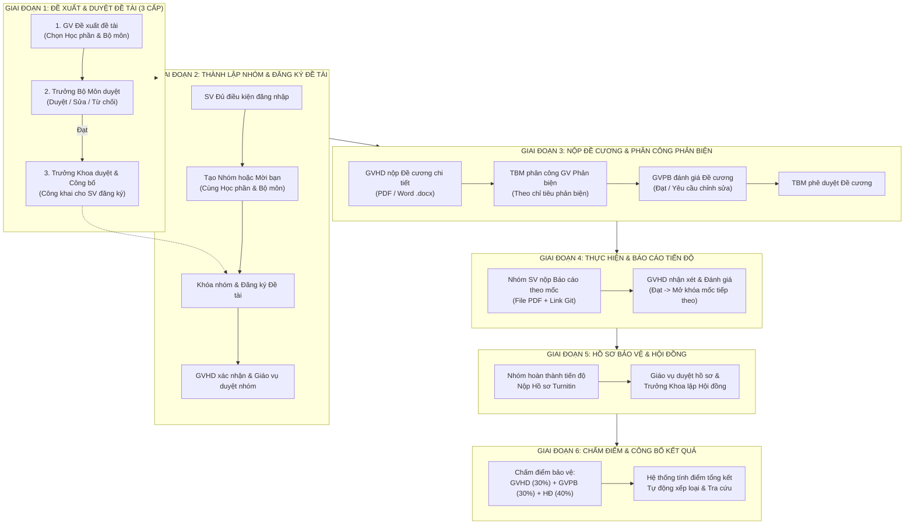

# 🎓 HỆ THỐNG QUẢN LÝ CÔNG TÁC KHÓA LUẬN TỐT NGHIỆP (HUIT)

> **TRƯỜNG ĐẠI HỌC CÔNG THƯƠNG TP. HỒ CHÍ MINH (HUIT)**  
> **Khoa Công Nghệ Thông Tin**  
> **Phiên bản**: 3.0 (Quy trình chuẩn hóa 5 cấp vai trò, 12 học phần khóa luận & Time Machine)  
> **Tech Stack**: Laravel 11.x | PHP 8.2+ | MySQL 8.x | Bootstrap 5 | Mozilla PDF.js | Mammoth.js | Chart.js | FullCalendar v6

---

## 📌 TỔNG QUAN HỆ THỐNG

Hệ thống **Quản lý Công tác Khóa luận Tốt nghiệp HUIT** là nền tảng quản trị và vận hành toàn diện quy trình khóa luận tốt nghiệp theo chuẩn đào tạo tín chỉ, phục vụ 5 phân quyền vai trò người dùng trong trường đại học:

1. **Giáo vụ Khoa / Quản trị viên (Admin)**: Quản lý danh mục nền (Khoa, Bộ môn, Ngành, Lớp, Học kỳ, Học phần), xét duyệt danh sách sinh viên đủ điều kiện, thiết lập mốc thời gian kế hoạch khóa luận, quản lý chỉ tiêu hướng dẫn/phản biện, quản trị tài khoản, nhập/xuất dữ liệu Excel/CSV và theo dõi Dashboard thống kê.
2. **Trưởng Khoa (Dean)**: Phê duyệt đề tài cấp Khoa, ra quyết định công bố đề tài cho sinh viên đăng ký, thành lập Hội đồng bảo vệ khóa luận và theo dõi báo cáo kết quả tổng kết toàn khoa.
3. **Trưởng Bộ Môn (Head of Department)**: Phê duyệt đề tài cấp Bộ môn (Duyệt/Yêu cầu chỉnh sửa/Từ chối), duyệt đề cương chi tiết, phân công giảng viên phản biện theo chỉ tiêu năng lượng của từng giảng viên trong bộ môn.
4. **Giảng viên (Lecturer / Supervisor / Reviewer)**: Đề xuất đề tài theo học phần khóa luận, nộp đề cương chi tiết, hướng dẫn nhóm sinh viên, đánh giá tiến độ các mốc báo cáo, chấm điểm phản biện và chấm điểm Hội đồng bảo vệ.
5. **Sinh viên (Student)**: Xem thông báo điều kiện khóa luận, khởi tạo nhóm (2-3 sinh viên cùng học phần & bộ môn), mời thành viên, đăng ký đề tài đã công bố, nộp báo cáo tiến độ các mốc (PDF/Git), nộp hồ sơ bảo vệ (Turnitin) và tra cứu kết quả điểm tổng kết.

---

## 🛠️ TECH STACK & CÔNG NGHỆ SỬ DỤNG

- **Backend**: [Laravel 11.x](https://laravel.com/) (PHP 8.2+ / 8.3)
- **Database**: MySQL 8.x / MariaDB (Bộ mã hóa `utf8mb4_unicode_ci`)
- **Frontend**: Blade Templating, Bootstrap 5.3, FontAwesome 6, Custom HUIT Theme (`#00529B`, `#004E64`)
- **Trình đọc tài liệu nhúng**:
  - **Mozilla PDF.js v3.11** (`pdf.min.js` & `pdf.worker.min.js`): Giải mã và hiển thị tệp PDF trực tiếp lên thẻ HTML5 Canvas (chống lỗi chặn iframe/CSP của Chrome).
  - **Mammoth.js**: Đọc và chuyển đổi tệp tài liệu Microsoft Word (`.docx`) sang HTML trực tiếp trên trình duyệt.
- **Xử lý Excel / CSV**: [PhpSpreadsheet](https://phpspreadsheet.readthedocs.io/) (Hỗ trợ định dạng XLSX và CSV UTF-8 BOM chuẩn dấu tiếng Việt trên Microsoft Excel).
- **Trực quan hóa dữ liệu**: Chart.js (Biểu đồ Doughnut, Bar chart tiến độ) & FullCalendar v6 (Lịch kế hoạch).
- **Công cụ giả lập quy trình**: **Time Machine (Cỗ máy thời gian)** chạy trên nền Cookie/Session cho phép tua nhanh/lùi ngày giờ hệ thống để kiểm thử toàn bộ các mốc thời gian thực tế mà không cần chỉnh sửa đồng hồ máy chủ.

---

## 🔄 QUY TRÌNH NGHIỆP VỤ TOÀN DIỆN (6 GIAI ĐOẠN)



---

## 💻 HƯỚNG DẪN CÀI ĐẶT & TRIỂN KHAI

### 1. Yêu cầu môi trường
- PHP >= 8.2 (Bật các extension: `pdo_mysql`, `mbstring`, `fileinfo`, `gd`, `zip`, `openssl`, `curl`)
- MySQL >= 8.0 hoặc MariaDB >= 10.4
- [Composer](https://getcomposer.org/) >= 2.x
- [Git](https://git-scm.com/)
- Công cụ web server: Laragon (khuyến nghị trên Windows) hoặc XAMPP / Docker / PHP built-in server.

### 2. Các bước cài đặt chi tiết

```bash
# 1. Clone repository từ GitHub
git clone -b thuy-duong https://github.com/ChjZung/Graduation-Thesis-Management-System.git
cd Graduation-Thesis-Management-System

# 2. Cài đặt các gói phụ thuộc PHP qua Composer
composer install

# 3. Tạo file cấu hình môi trường (.env)
cp .env.example .env

# 4. Sinh Application Key
php artisan key:generate

# 5. Cấu hình kết nối cơ sở dữ liệu trong file .env
# DB_CONNECTION=mysql
# DB_HOST=127.0.0.1
# DB_PORT=3306
# DB_DATABASE=quanly_doan
# DB_USERNAME=root
# DB_PASSWORD=

# 6. Chạy migration tạo cấu trúc cơ sở dữ liệu
php artisan migrate

# 7. Tạo liên kết lưu trữ công khai (Symlink Storage)
php artisan storage:link

# 8. (Tùy chọn) Chạy seed dữ liệu mẫu nền hoặc import từ thư mục sample_imports
php scripts/export_all_sample_imports.php

# 9. Khởi chạy máy chủ phát triển
php artisan serve
```

Truy cập hệ thống tại: `http://127.0.0.1:8000` hoặc qua Virtual Host của Laragon.

---

## 📁 HƯỚNG DẪN IMPORT DỮ LIỆU EXCEL / CSV MẪU

Toàn bộ dữ liệu mẫu chuẩn hóa nằm trong thư mục [`sample_imports/`](file:///D:/KhoaLuanTotNghiep/Graduation-Thesis-Management-System/sample_imports/). Để đảm bảo tính toàn vẹn khóa ngoại, vui lòng thực hiện import theo đúng thứ tự đánh số:

| Thứ tự | File Import (`.xlsx` / `.csv`) | Bảng đích | Mục đích & Lưu ý |
|:---:|---|---|---|
| **01** | `01_Khoa_Mau.xlsx` | `khoa` | Danh mục Khoa (VD: `CNTT`, `NN`...). |
| **02** | `02_BoMon_Mau.xlsx` | `bomon` | 6 Bộ môn trực thuộc Khoa CNTT (`CNPM`, `HTTT`, `ATTT`, `MMT`, `KHMT`, `KHDL`). |
| **03** | `03_Nganh_Mau.xlsx` | `nganh` | Các ngành đào tạo (`7480201` - CNTT, KTPM, HTTT, ATTT...). |
| **04** | `04_Lop_Mau.xlsx` | `lop` | Danh sách lớp sinh viên (`12DHCNTT01`, `12DHCNTT02`, `12DHKPM01`...). |
| **05** | `05_HocKy_Mau.xlsx` | `hocky` | Danh mục học kỳ (Học kỳ hiện hành: `HK2627_1`). |
| **06** | `06_GiangVien_Mau.xlsx` | `giangvien` & `taikhoan` | 27 Giảng viên thuộc 6 bộ môn. **Tự động sinh tài khoản Giảng viên** (`VT02`). |
| **07** | `07_SinhVien_Mau.xlsx` | `sinhvien` & `taikhoan` | 35 Sinh viên. **Tự động sinh tài khoản Sinh viên** (`VT03`). |
| **08** | `09_SinhVien_TheoHocKy_Mau.xlsx` | `danhsachsvdudieukien` | 35 Sinh viên đủ điều kiện làm khóa luận theo học kỳ `HK2627_1`. |
| **09** | `10_HocPhan_KhoaLuan_Mau.xlsx` | `hocphan` | 12 Học phần khóa luận (mỗi bộ môn gồm 2 hệ: Cử nhân `HP_KLCN_*` & Tốt nghiệp `HP_KLTN_*`). |
| **10** | `11_DeTai_KhoaLuan_Mau.xlsx` | `detai` & `chitietduyetdetai` | 26 Đề tài khóa luận mẫu đầy đủ thông tin GVHD, học phần, mô tả, yêu cầu. |

> **Lưu ý về Tài khoản Quản lý**: Hệ thống không cần file tài khoản riêng. Tài khoản Trưởng Khoa (`TK_CNTT_GV00000001`) và Trưởng Bộ Môn (`TBM_CNTT_CNPM_GV00000002`...) được tự động liên kết với hồ sơ Giảng viên tương ứng.

---

## 🔑 DANH SÁCH TÀI KHOẢN THỬ NGHIỆM

Mật khẩu mặc định cho toàn bộ các tài khoản thử nghiệm: **`Huit@2026`** (hoặc `123456` đối với các tài khoản tạo sớm).

| Vai Trò | Tên Đăng Nhập | Họ và Tên | Đơn vị / Chức vụ | Ghi chú |
|---|---|---|---|---|
| **Admin / Giáo vụ** | `admin` | Ban Quản Trị Hệ Thống | Phòng Đào Tạo / Giáo Vụ | Toàn quyền quản trị danh mục & kế hoạch |
| **Trưởng Khoa** | `TK_CNTT_GV00000001` | PGS.TS. Nguyễn Văn Hùng | Trưởng Khoa CNTT | Duyệt đề tài cấp Khoa, Lập Hội đồng |
| **Trưởng Bộ Môn CNPM** | `TBM_CNTT_CNPM_GV00000002` | TS. Trần Anh Dũng | Trưởng Bộ Môn CNPM | Duyệt đề tài BM, Phân công phản biện |
| **Trưởng Bộ Môn HTTT** | `TBM_CNTT_HTTT_GV00000003` | TS. Phạm Minh Tuấn | Trưởng Bộ Môn HTTT | Duyệt đề tài BM HTTT |
| **Trưởng Bộ Môn ATTT** | `TBM_CNTT_ATTT_GV00000004` | TS. Trịnh Văn Thành | Trưởng Bộ Môn ATTT | Duyệt đề tài BM ATTT |
| **Trưởng Bộ Môn MMT** | `TBM_CNTT_MMT_GV00000005` | TS. Lê Hải Đăng | Trưởng Bộ Môn MMT | Duyệt đề tài BM MMT |
| **Trưởng Bộ Môn KHMT** | `TBM_CNTT_KHMT_GV00000006` | PGS.TS. Võ Quốc Phong | Trưởng Bộ Môn KHMT | Duyệt đề tài BM KHMT |
| **Trưởng Bộ Môn KHDL** | `TBM_CNTT_KHDL_GV00000007` | TS. Đỗ Anh Minh | Trưởng Bộ Môn KHDL | Duyệt đề tài BM KHDL |
| **Giảng Viên** | `GV00000021` | ThS. Đặng Hải Giang | Bộ Môn CNPM | GV Hướng dẫn & Phản biện |
| **Giảng Viên** | `GV00000023` | TS. Lê Hoàng Cường | Bộ Môn CNPM | GV Hướng dẫn đề tài DT26 |
| **Sinh Viên (Trưởng nhóm)**| `2001210001` | Nguyễn Hoàng Long | Lớp 12DHCNTT01 | Trưởng nhóm N01 làm đề tài DT26 |
| **Sinh Viên (Thành viên)** | `2001210002` | Trần Minh Quân | Lớp 12DHCNTT01 | Thành viên nhóm N01 |
| **Sinh Viên (Thành viên)** | `2001210003` | Lê Phương Anh | Lớp 12DHCNTT01 | Thành viên nhóm N01 |

---

## ⏰ CÔNG CỤ TIME MACHINE (GIẢ LẬP MỐC THỜI GIAN)

Hệ thống tích hợp thanh công cụ **Time Machine** cố định ở góc dưới cùng bên phải màn hình:
- **Mục đích**: Cho phép giảng viên, sinh viên và ban đánh giá kiểm thử trọn vẹn toàn bộ vòng đời khóa luận kéo dài 4-5 tháng chỉ trong vài phút.
- **Cách sử dụng**:
  1. Nhấp vào nút **Time Machine** ở góc dưới màn hình.
  2. Chọn mốc thời gian muốn kiểm thử:
     - `09/08/2026`: Thời gian Giảng viên đề xuất & Bộ môn/Khoa duyệt đề tài.
     - `10/08/2026 10:00`: Thời gian Sinh viên lập nhóm & Đăng ký đề tài.
     - `11/08/2026 09:30`: Thời gian hết hạn lập nhóm, bước vào giai đoạn nộp đề cương & phân công phản biện.
     - Hoặc nhập bất kỳ ngày giờ nào theo ý muốn.
  3. Bấm **"Áp dụng"**: Toàn bộ hệ thống sẽ phản hồi chính xác theo thời gian ảo đã chọn (chặn nút tạo nhóm khi hết hạn, mở khóa form nộp bài, tính hạn nộp báo cáo...).
  4. Bấm **"Khôi phục thời gian thực"** để quay về giờ hiện tại của máy tính.

---

## 🌟 CÁC TÍNH NĂNG NỔI BẬT ĐÃ HOÀN THIỆN

1. **Trình Xem Nhanh Đề Cương Chi Tiết (PDF.js & Mammoth.js)**:
   - Tích hợp bộ đọc **Mozilla PDF.js** độc lập, kết xuất trực tiếp tệp PDF thành các trang Canvas siêu nét bên trong popup modal, hoàn toàn không bị lỗi màn hình xám / gạch chéo đỏ của Chrome iframe.
   - Hỗ trợ xem cả tệp Word `.docx` chuẩn A4 trực tiếp trên web bằng Mammoth.js.
   - Bổ sung thanh công cụ điều hướng: Lật trang, Phóng to / Thu nhỏ, Căn vừa chiều ngang (`Fit width`), nút Mở tab riêng và Tải tệp về máy tính.
2. **Nút "Đọc hết" Thông Báo Thông Minh**:
   - Tích hợp nút **Đọc hết** ngay trong dropdown chuông thông báo trên Header của tất cả các vai trò.
   - Khi bấm, huy hiệu số đỏ trên icon chuông biến mất tức thì trên giao diện và đồng bộ trạng thái đã đọc vào Session của server qua AJAX.
3. **Phân Công Phản Biện Động Theo Chỉ Tiêu**:
   - Trưởng bộ môn quản lý chỉ tiêu phản biện từng giảng viên (`chitieuphanbien`).
   - Cảnh báo trực quan khi giảng viên đạt hoặc vượt ngưỡng số lượng đề tài phản biện.
4. **Kiểm Soát Tạo Nhóm Chặt Chẽ**:
   - Chỉ những sinh viên có trong danh sách đủ điều kiện mới được tạo nhóm.
   - Chặn tuyệt đối việc tạo nhóm khác bộ môn hoặc khác học phần đào tạo.
   - Tự động đóng cổng tạo nhóm và hiển thị thông báo trạng thái khi kế hoạch bước sang giai đoạn sau.

---

## 📂 CẤU TRÚC THƯ MỤC CHÍNH

```
Graduation-Thesis-Management-System/
├── app/
│   ├── Http/Controllers/
│   │   ├── Admin/              # Controllers Giáo vụ Khoa / Quản trị
│   │   ├── GiangVien/           # Controllers Giảng viên hướng dẫn & phản biện
│   │   ├── SinhVien/            # Controllers Sinh viên thực hiện khóa luận
│   │   ├── TruongBoMon/         # Controllers Trưởng bộ môn phê duyệt & phân công
│   │   ├── TruongKhoa/          # Controllers Trưởng khoa duyệt & hội đồng
│   │   └── ThongBaoController.php
│   ├── Models/                  # 31 Eloquent Models theo chuẩn CSDL HUIT
│   └── Services/                # Dịch vụ nghiệp vụ (Excel, ChiTieu, PlanPhase, TimeMachine...)
├── database/
│   ├── migrations/              # Toàn bộ migration định nghĩa 31 bảng CSDL
│   └── seeders/                 # Seeders dữ liệu khởi tạo
├── public/
│   ├── js/                      # Thư viện PDF.js, Mammoth.js, Chart.js, Bootstrap
│   └── css/                     # HUIT theme stylesheet
├── resources/views/
│   ├── layouts/                 # 5 Layouts riêng biệt cho 5 vai trò
│   ├── partials/                # Header notifications, Modal preview đề cương, Editor...
│   ├── admin/
│   ├── giangvien/
│   ├── sinhvien/
│   ├── truongbomon/
│   └── truongkhoa/
├── sample_imports/              # 10 bộ file mẫu Excel (.xlsx) & CSV UTF-8 có BOM
├── scripts/                     # Scripts hỗ trợ xuất dữ liệu, kiểm tra blade, setup dữ liệu
└── routes/web.php               # Định tuyến toàn bộ hệ thống
```

---

## 👥 THÀNH VIÊN DỰ ÁN

- **Khoa Công Nghệ Thông Tin — Trường Đại Học Công Thương TP. Hồ Chí Minh (HUIT)**
- **Nhánh phát triển chính thức**: `thuy-duong`
- **Tác giả / Nhóm thực hiện**: Thùy Dương & Nhóm phát triển Hệ thống Quản lý Khóa Luận Tốt Nghiệp HUIT.

---
*Bản quyền © 2026 Khoa CNTT - Trường Đại Học Công Thương TP. Hồ Chí Minh.*
