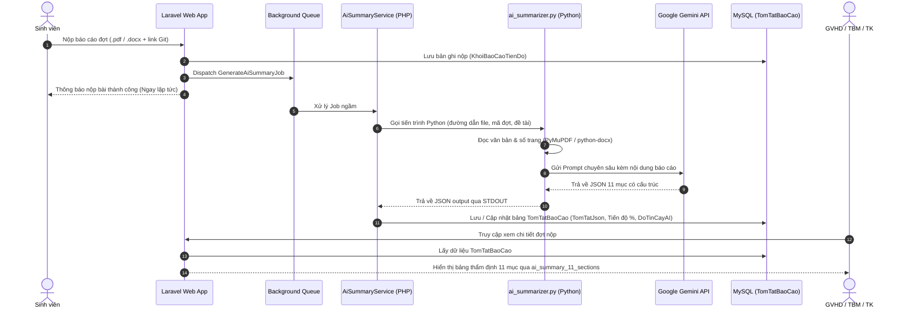

# 🤖 MODULE TRỢ LÝ AI PHÂN TÍCH & THẨM ĐỊNH TIẾN ĐỘ KHÓA LUẬN

> **Thư mục tổng hợp mã nguồn & tài liệu kỹ thuật chức năng AI**  
> *Hệ thống Quản lý Công tác Khóa luận Tốt nghiệp — HUIT*  
> *Lưu ý: Các file trong thư mục này là bản sao tập trung từ các thư mục gốc của dự án (`app/`, `resources/`, `docs/`) nhằm phục vụ việc nghiên cứu, đọc hiểu kiến trúc và triển khai AI mà không làm ảnh hưởng đến mã nguồn đang chạy của hệ thống.*

---

## 📑 MỤC LỤC
1. [Tổng Quan Chức Năng](#1-tổng-quan-chức-năng)
2. [Cấu Trúc Thư Mục Module AI](#2-cấu-trúc-thư-mục-module-ai)
3. [Sơ Đồ Kiến Trúc & Luồng Dữ Liệu (Pipeline)](#3-sơ-đồ-kiến-trúc--luồng-dữ-liệu-pipeline)
4. [Chi Tiết Cấu Trúc 11 Mục Thẩm Định Chuyên Sâu](#4-chi-tiết-cấu-trúc-11-mục-thẩm-định-chuyên-sâu)
5. [Mô Tả Chức Năng Từng File](#5-mô-tả-chức-năng-từng-file)
6. [Cơ Chế Dự Phòng (Fallback) & Độ Tin Cậy](#6-cơ-chế-dự-phòng-fallback--độ-tin-cậy)
7. [Hướng Dẫn Cài Đặt & Triển Khai](#7-hướng-dẫn-cài-đặt--triển-khai)
8. [Cách Chạy Kiểm Thử & Đo Lường Chất Lượng (Benchmark)](#8-cách-chạy-kiểm-thử--đo-lường-chất-lượng-benchmark)

---

## 1. TỔNG QUAN CHỨC NĂNG

Chức năng **Trợ lý AI Phân tích & Thẩm định Báo cáo Tiến độ** được thiết kế nhằm hỗ trợ Giảng viên hướng dẫn (GVHD), Trưởng bộ môn (TBM), Trưởng khoa (TK) và Giáo vụ (Admin) tự động rà soát, đánh giá nhanh chóng và chính xác các báo cáo tiến độ do sinh viên nộp lên hệ thống.

### Các lợi ích cốt lõi:
* **Tự động đọc & trích xuất:** Hỗ trợ đọc tài liệu PDF (qua PyMuPDF) và Microsoft Word `.docx`.
* **Phân tích ngữ nghĩa chuyên sâu:** Sử dụng mô hình ngôn ngữ lớn (Google Gemini LLM / NLP engine) để phân tích khối lượng công việc thực tế, đối chiếu với mục tiêu đề tài.
* **Cấu trúc thẩm định 11 phần chuẩn mực:** Không chỉ tóm tắt ngắn, AI đánh giá tiến độ %, chỉ ra rủi ro, kiểm tra trích dẫn số trang và đề xuất định hướng tiếp theo.
* **Xử lý nền không nghẽn giao diện (Asynchronous Queue Job):** Khi sinh viên nộp báo cáo, hệ thống lập tức đẩy vào hàng đợi nền để giao diện phản hồi tức thì (<1 giây), kết quả AI được cập nhật sau khi phân tích xong.

---

## 2. CẤU TRÚC THƯ MỤC MODULE AI

```text
ai_module/
├── README.md                                 # [File hiện tại] Tài liệu kiến trúc & hướng dẫn chi tiết
├── services/                                 # Lớp xử lý dịch vụ logic & script AI backend
│   ├── AiSummaryService.php                  # Service PHP điều phối phân tích, gọi script, quản lý cache & lưu DB
│   └── ai_summarizer.py                      # Script Python đọc file PDF/Word, gọi Gemini API & trích xuất JSON
├── jobs/                                     # Lớp xử lý hàng đợi bất đồng bộ
│   └── GenerateAiSummaryJob.php              # Laravel Queue Job chạy ngầm phân tích tài liệu khi có nộp mới
├── models/                                   # Lớp ánh xạ cơ sở dữ liệu
│   └── TomTatBaoCao.php                      # Model Eloquent quản lý bảng `TomTatBaoCao`
├── commands/                                 # Lệnh Artisan kiểm thử & đo lường hiệu năng
│   ├── AiEvaluateScenariosCommand.php        # Đánh giá thực nghiệm 18 kịch bản báo cáo tiến độ
│   └── AiProgressBenchmarkCommand.php        # Benchmark đo độ chính xác, độ trễ và tỷ lệ thành công
├── views/                                    # Lớp giao diện hiển thị kết quả
│   └── ai_summary_11_sections.blade.php      # Component Blade hiển thị 11 mục thẩm định trực quan, chuyên nghiệp
└── docs/                                     # Báo cáo thực nghiệm & nghiên cứu khoa học
    ├── ai_benchmark_report.md                # Báo cáo đánh giá hiệu năng và các chỉ số AI
    ├── ai_benchmark_results.json             # Kết quả đo đạc JSON thực tế
    ├── KET_QUA_DANH_GIA_THUC_NGHIEM_18_SCENARIOS.md # Phân tích 18 kịch bản đồ án sinh viên
    ├── NGHIEN_CUU_AI_BAO_CAO_TIEN_DO.md      # Tài liệu nghiên cứu phương pháp luận & cơ sở khoa học
    └── README.md                             # Tổng quan các tài liệu nghiên cứu
```

---

## 3. SƠ ĐỒ KIẾN TRÚC & LUỒNG DỮ LIỆU (PIPELINE)



---

## 4. CHI TIẾT CẤU TRÚC 11 MỤC THẨM ĐỊNH CHUYÊN SÂU

Kết quả phân tích được chuẩn hóa thành 11 mục trong JSON và hiển thị trên giao diện:

| STT | Tên mục thẩm định | Ý nghĩa & Dữ liệu trích xuất |
|:---:|:---|:---|
| **1** | **Mục Tiêu Trọng Tâm** | Xác định mục tiêu kỹ thuật chính của đợt nộp hiện tại dựa theo tên đợt và đề tài. |
| **2** | **Tóm Tắt Tổng Quan** | Tóm tắt súc tích (100–150 từ) các kết quả sinh viên đã đạt được trong phiên bản này. |
| **3** | **Tiến Độ Ước Lượng (%)** | Tỷ lệ % hoàn thành đợt nộp do AI thẩm định dựa trên khối lượng công việc thực tế. |
| **4** | **Bảng Công Việc Chi Tiết** | Danh sách các task cụ thể: Tên công việc, Kết quả đạt được, Mức độ hoàn thành (Đạt / Đang làm / Chưa đạt). |
| **5** | **Khó Khăn & Tồn Tại** | Các trở ngại kỹ thuật, lỗi phát sinh hoặc rào cản sinh viên đang gặp phải. |
| **6** | **Kế Hoạch Đợt Tới** | Các đầu việc sinh viên dự kiến thực hiện trong đợt nộp tiếp theo. |
| **7** | **Đề Xuất Hỗ Trợ Từ GVHD** | Những điểm vướng mắc cần GVHD giải đáp, góp ý chuyên môn hoặc định hướng kiến trúc. |
| **8** | **Đánh Giá Chất Lượng Báo Cáo** | Đánh giá 3 khía cạnh: Cấu trúc văn bản, Độ rõ ràng/minh chứng, và Chất lượng mã nguồn Git. |
| **9** | **Cảnh Báo Rủi Ro** | Nhận diện nguy cơ chậm tiến độ, thiếu hụt chức năng cốt lõi hoặc mã nguồn chưa hoàn thiện. |
| **10** | **Trích Dẫn & Số Trang** | Đoạn trích dẫn nguyên văn từ tài liệu kèm số trang cụ thể (Page X) để minh chứng tính xác thực. |
| **11** | **Đánh Giá Chung Của AI** | Kết luận tổng thể (Khá/Tốt/Cần cải thiện) và khuyến nghị xử lý dành cho Giảng viên. |

---

## 5. MÔ TẢ CHỨC NĂNG TỪNG FILE

### 5.1. `services/AiSummaryService.php` *(Vị trí gốc: `app/Services/AiSummaryService.php`)*
* **Vai trò:** Trung tâm điều phối (Orchestrator) toàn bộ luồng thẩm định AI phía PHP.
* **Chức năng chính:**
  * Xác định môi trường thực thi (đường dẫn Python binary trên Windows/Linux).
  * Kiểm tra tệp đính kèm (`.pdf`, `.docx`) trong thư mục lưu trữ `storage/app/public/`.
  * Thực thi `ai_summarizer.py` bằng `Symfony\Component\Process\Process` với timeout an toàn.
  * Phân tích cú pháp JSON kết quả và chuẩn hóa cấu trúc 11 mục.
  * Tích hợp cơ chế fallback tự động bằng thuật toán phân tích nội dung nội bộ khi Python hoặc API gặp sự cố.
  * Lưu trữ kết quả vào bảng `TomTatBaoCao` và cập nhật tiến độ liên quan.

### 5.2. `services/ai_summarizer.py` *(Vị trí gốc: `app/Services/ai_summarizer.py`)*
* **Vai trò:** Script xử lý AI độc lập viết bằng Python.
* **Chức năng chính:**
  * Nhận tham số qua dòng lệnh: `--file`, `--topic`, `--phase`, `--notes`.
  * Sử dụng thư viện `fitz` (PyMuPDF) để trích xuất văn bản từng trang PDF với độ chính xác cao.
  * Sử dụng `docx` để đọc các tệp Word.
  * Tạo Prompt hệ thống yêu cầu mô hình AI đóng vai trò **Chuyên gia Thẩm định Học thuật Đồ án Tốt nghiệp**.
  * Gọi Google Gemini API (`models/gemini-1.5-flash` hoặc `gemini-pro`) với chế độ `response_mime_type="application/json"`.
  * Trả về chuỗi JSON 11 mục qua luồng đầu ra tiêu chuẩn (stdout).

### 5.3. `jobs/GenerateAiSummaryJob.php` *(Vị trí gốc: `app/Jobs/GenerateAiSummaryJob.php`)*
* **Vai trò:** Job chạy ngầm thông qua Laravel Queue.
* **Chức năng chính:**
  * Tiếp nhận `MaBaoCao` hoặc `MaKhoi`.
  * Chạy ngầm trong background worker để sinh viên không phải chờ đợi khi upload tài liệu nặng.
  * Ghi nhật ký tiến trình (Log::info, Log::error) phục vụ việc theo dõi và debug.

### 5.4. `models/TomTatBaoCao.php` *(Vị trí gốc: `app/Models/TomTatBaoCao.php`)*
* **Vai trò:** Model Eloquent ánh xạ bảng cơ sở dữ liệu `TomTatBaoCao`.
* **Thuộc tính quan trọng:**
  * `MaTomTat`: Khóa chính định danh bản ghi tóm tắt.
  * `MaBaoCao`, `MaKhoi`: Liên kết tới đợt nộp hoặc khối báo cáo.
  * `TomTatJson`: Cột kiểu JSON lưu toàn bộ 11 mục thẩm định.
  * `SoTrang`: Tổng số trang văn bản được AI phát hiện.
  * `DoTinCayAI`: Điểm tin cậy ước tính của mô hình (90–98%).
  * `ThoiGianXuLy`: Thời gian xử lý tính bằng giây.

### 5.5. `views/ai_summary_11_sections.blade.php` *(Vị trí gốc: `resources/views/partials/ai_summary_11_sections.blade.php`)*
* **Vai trò:** Giao diện hiển thị kết quả phân tích AI.
* **Thiết kế:**
  * Tích hợp trực tiếp vào trang chi tiết đợt nộp của Sinh viên (`sinhvien/baocao/show_dot.blade.php`), Giảng viên (`giangvien/baocao/show_dot.blade.php`), và Admin/TBM/TK.
  * Giao diện Card hiện đại, phối màu trực quan: Badge % tiến độ, bảng công việc phân màu, trích dẫn minh chứng rõ ràng.

### 5.6. `commands/` *(Vị trí gốc: `app/Console/Commands/`)*
* `AiProgressBenchmarkCommand.php`: Thực hiện đo đạc các chỉ số: độ trễ (latency), độ hoàn chỉnh của 11 mục, độ hợp lệ JSON và tỷ lệ thành công.
* `AiEvaluateScenariosCommand.php`: Chạy thử nghiệm 18 kịch bản đồ án điển hình (ví dụ: nhóm hoàn thành tốt, nhóm thiếu mã nguồn, nhóm nộp sai nội dung, nhóm gặp lỗi kỹ thuật) để kiểm chứng tính khách quan của AI.

---

## 6. CƠ CHẾ DỰ PHÒNG (FALLBACK) & ĐỘ TIN CẬY

Hệ thống được thiết kế theo nguyên tắc **Zero-Failure** (không bao giờ làm đứt gãy trải nghiệm người dùng):

1. **Cơ chế Thử Lại (Retry Policy):**
   * Khi gọi Gemini API gặp mã lỗi 429 (Rate Limit) hoặc 503 (Service Unavailable), script tự động áp dụng Exponential Backoff để thử lại tối đa 3 lần.
2. **Fallback Thuật Toán Cục Bộ (Rule-based Fallback):**
   * Nếu máy chủ mất kết nối Internet hoặc chưa cấu hình API Key, `AiSummaryService` tự động kích hoạt bộ parser nội bộ.
   * Bộ parser dựa trên các biểu thức chính quy (Regex) và phân tích từ khóa cấu trúc (như "kết quả", "khó khăn", "kế hoạch") để trích xuất đầy đủ 11 mục, đảm bảo giao diện luôn có dữ liệu hiển thị.
3. **Bảo toàn dữ liệu gốc:**
   * Tệp đính kèm và nhận xét của sinh viên luôn được bảo toàn độc lập; kết quả AI chỉ mang tính chất tham vấn, thẩm định bổ trợ.

---

## 7. HƯỚNG DẪN CÀI ĐẶT & TRIỂN KHAI

### Bước 1: Yêu cầu môi trường
* PHP 8.2 trở lên với các extension: `pdo`, `mbstring`, `fileinfo`.
* Python 3.10 trở lên đã thêm vào biến môi trường PATH hệ thống.

### Bước 2: Cài đặt các thư viện Python cần thiết
Mở Terminal/PowerShell tại thư mục dự án và chạy lệnh:
```bash
pip install pymupdf python-docx google-generativeai requests
```

### Bước 3: Cấu hình API Key trong tệp `.env`
Mở tệp `.env` của dự án và khai báo khóa Gemini API:
```env
GEMINI_API_KEY=your_gemini_api_key_here
GEMINI_MODEL=gemini-1.5-flash
```
*(Nếu chưa có API Key, bạn có thể lấy miễn phí tại [Google AI Studio](https://aistudio.google.com/)).*

### Bước 4: Chạy Queue Worker để xử lý nền
Để xử lý các tác vụ AI ngầm:
```bash
php artisan queue:work --tries=3 --timeout=120
```

---

## 8. CÁCH CHẠY KIỂM THỬ & ĐO LƯỜNG CHẤT LƯỢNG (BENCHMARK)

Hệ thống đã tích hợp sẵn 2 công cụ kiểm chuẩn chất lượng thông qua Artisan CLI:

### 1. Chạy đánh giá đo lường hiệu năng tổng thể:
```bash
php artisan ai:benchmark
```
*Lệnh sẽ kiểm tra thời gian xử lý trung bình, độ đầy đủ của 11 mục, và xuất báo cáo tại `docs/ai_research/ai_benchmark_report.md`.*

### 2. Chạy kiểm thử nghiệm thu 18 kịch bản đồ án thực tế:
```bash
php artisan ai:evaluate-scenarios
```
*Lệnh sẽ mô phỏng 18 tình huống thực tế của sinh viên (chậm tiến độ, nộp đủ bài, thiếu file, đồ án công nghệ phức tạp...) để đánh giá độ chuẩn xác của kết quả thẩm định.*

---

*Tài liệu được biên soạn đồng bộ cho Hệ thống Quản lý Khóa luận Tốt nghiệp HUIT.*
