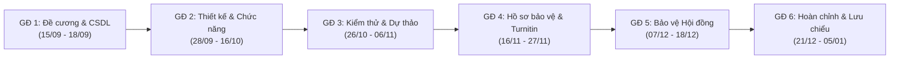

# KỊCH BẢN KIỂM THỬ TOÀN DIỆN: QUẢN LÝ TIẾN ĐỘ KHÓA LUẬN & TÓM TẮT BÁO CÁO AI
**Dự án**: Hệ Thống Quản Lý Đồ Án & Khóa Luận Tốt Nghiệp HUIT  
**Phiên bản**: 2.0 (Hỗ trợ 6 Giai đoạn, Báo cáo nhỏ Sub-reports, AI Map-Reduce PDF & Giờ ảo Time Machine)  
**Ngày lập**: 16/10/2026  
**Mục tiêu**: Đảm bảo luồng vận hành từ Giai đoạn 1 đến Giai đoạn 6 hoạt động chính xác tuyệt đối ở mọi trường hợp (Boundary cases, Sequential lock, AI extraction, Review workflow, và Milestone confirmation).

---

## I. MÔI TRƯỜNG & TÀI KHOẢN KIỂM THỬ

| Vai trò | Tên đăng nhập | Mật khẩu | Nhóm / Đối tượng kiểm thử |
| :--- | :--- | :--- | :--- |
| **Giáo vụ (Admin)** | `admin` | `123456` | Giám sát toàn khóa, điều phối và cảnh báo tiến độ |
| **Giảng viên hướng dẫn (GVHD)** | `GV00000001` | `123456` | Thẩm định báo cáo nhỏ, đối chiếu AI, duyệt giai đoạn |
| **Sinh viên (Trưởng nhóm)** | `2001210001` | `123456` | Nhóm N01 / NH01 (Đề tài đã duyệt: HT Quản lý khóa luận) |
| **Sinh viên (Thành viên)** | `2001210002` | `123456` | Xem tiến độ, nhật ký công việc của nhóm |

### Công cụ hỗ trợ test thời gian (Time Machine Widget)
- Widget nổi ở góc dưới bên phải màn hình: `⏰ Giờ ảo (Time Machine)`.
- Cho phép tua thời gian 1-Click sang các mốc kiểm thử hoặc nhập thời gian tùy chọn.
- Endpoint xử lý: `POST /dev/mock-time` & `POST /dev/reset-mock-time`.

---

## II. DANH MỤC 6 GIAI ĐOẠN TIẾN ĐỘ CHUẨN

---

## III. MA TRẬN KỊCH BẢN KIỂM THỬ (TEST CASES)

### KỊCH BẢN 1: KIỂM SOÁT THỜI GIAN NỘP BÁO CÁO (BOUNDARY & DEADLINE)

#### Test Case 1.1: Chặn nộp bài trước ngày bắt đầu mở đợt
- **Mục tiêu**: Kiểm tra quy tắc Rule C1 chặn server-side khi chưa đến ngày mở nhận bài.
- **Dữ liệu chuẩn bị**: 
  - Mở Time Machine $\rightarrow$ Chọn mốc `10/09/2026 09:00:00` (Trước hạn GĐ 1 mở ngày 15/09).
  - Đăng nhập tài khoản Sinh viên `2001210001`.
- **Các bước thực hiện**:
  1. Vào menu **Báo Cáo Tiến Độ** (`/sinhvien/baocao`).
  2. Quan sát huy hiệu trạng thái của GĐ 1 và nút nộp bài.
  3. Thử gửi POST request trực tiếp lên `/sinhvien/baocao`.
- **Kết quả kỳ vọng**:
  - Huy hiệu hiển thị: `Chưa mở nộp (Từ 15/09/2026)`.
  - Nút nộp bị vô hiệu hóa (disabled) kèm icon ổ khóa 🔒.
  - Server-side trả về lỗi: *"Chỉ được nộp báo cáo tiến độ đợt 1 từ ngày 15/09/2026 trở đi! Hiện tại hệ thống chưa mở nhận bài."*
- **Trạng thái**: [x] Pass

#### Test Case 1.2: Cho phép nộp bài khi đang trong khung thời gian hợp lệ
- **Mục tiêu**: Kiểm tra hệ thống mở cổng nhận bài đúng thời gian quy định.
- **Dữ liệu chuẩn bị**:
  - Mở Time Machine $\rightarrow$ Chọn mốc `16/09/2026 10:00:00` (Trong khung 15/09 - 18/09).
  - Đăng nhập tài khoản Sinh viên `2001210001`.
- **Các bước thực hiện**:
  1. Truy cập `/sinhvien/baocao`.
  2. Kiểm tra giao diện khung nộp bài.
- **Kết quả kỳ vọng**:
  - Huy hiệu hiển thị màu xanh lá: `Đang mở nộp bài`.
  - Hiển thị đầy đủ form nhập liệu và nút **`+ Tạo Báo Cáo Nhỏ Mới (Tích hợp AI)`**.
- **Trạng thái**: [x] Pass

#### Test Case 1.3: Chặn nộp bài khi đã quá hạn chót của giai đoạn
- **Mục tiêu**: Kiểm tra chặn nộp bài khi đã quá deadline mốc thời gian.
- **Dữ liệu chuẩn bị**:
  - Mở Time Machine $\rightarrow$ Chọn mốc `20/09/2026 09:00:00` (Hạn chót GĐ 1 là 18/09).
  - Đăng nhập tài khoản Sinh viên `2001210001`.
- **Các bước thực hiện**:
  1. Truy cập `/sinhvien/baocao`.
- **Kết quả kỳ vọng**:
  - Huy hiệu hiển thị: `Đã quá hạn nộp`.
  - Banner cảnh báo: *"Đã quá hạn nộp báo cáo tiến độ đợt 1! Hạn cuối nộp bài là 23:59 ngày 18/09/2026."*
- **Trạng thái**: [x] Pass

---

### KỊCH BẢN 2: TÍNH TUẦN TỰ GIỮA CÁC GIAI ĐOẠN (SEQUENTIAL LOCK)

#### Test Case 2.1: Chặn nộp giai đoạn tiếp theo khi giai đoạn trước chưa đạt
- **Mục tiêu**: Đảm bảo sinh viên không được "nhảy cóc" giai đoạn khi chưa được GVHD nghiệm thu.
- **Dữ liệu chuẩn bị**:
  - Nhóm sinh viên chưa hoàn thành GĐ 1 (Chưa nộp hoặc chưa có đánh giá "Đạt").
  - Mở Time Machine $\rightarrow$ Chọn ngày `05/10/2026` (Thời gian mở GĐ 2).
- **Các bước thực hiện**:
  1. Sinh viên vào `/sinhvien/baocao`.
  2. Thử truy cập trực tiếp URL tạo báo cáo GĐ 2: `/sinhvien/baocao/giai-doan/2/them-khoi` hoặc POST nộp bài với `LanBaoCao=2`.
- **Kết quả kỳ vọng**:
  - Stepper thể hiện GĐ 2 ở trạng thái ổ khóa mờ `Chưa mở`.
  - Hệ thống chặn và hiển thị thông báo lỗi: *"Bạn cần hoàn thành Giai đoạn 1 và được Giảng viên đánh giá 'Đạt' trước khi nộp Giai đoạn 2."*
- **Trạng thái**: [x] Pass

#### Test Case 2.2: Khóa chỉnh sửa giai đoạn khi đã được GVHD đánh giá Đạt
- **Mục tiêu**: Bảo toàn dữ liệu tiến độ đã được phê duyệt chính thức.
- **Dữ liệu chuẩn bị**: Giai đoạn 1 đã được GVHD đánh giá "Đạt".
- **Các bước thực hiện**:
  1. Sinh viên vào lại trang tiến độ `/sinhvien/baocao`.
  2. Thử bấm sửa báo cáo nhỏ đã Đạt.
- **Kết quả kỳ vọng**:
  - Hệ thống báo: *"Báo cáo đã được GVHD đánh giá Đạt, không thể chỉnh sửa."*
- **Trạng thái**: [x] Pass

---

### KỊCH BẢN 3: TẠO BÁO CÁO NHỎ & TÍCH HỢP AI MAP-REDUCE

#### Test Case 3.1: Tải lên file PDF và kích hoạt AI trích xuất nội dung
- **Mục tiêu**: Kiểm tra đường ống Map-Reduce xử lý PDF (PyMuPDF + NLP Heuristic / Gemini API).
- **Dữ liệu chuẩn bị**:
  - Tài liệu PDF đề cương/tiến độ (Ví dụ: `de_cuong_1792073636_cntt-klcn185-nguyen-van-le.pdf`).
  - Sinh viên tại màn hình `/sinhvien/baocao/giai-doan/1/them-khoi`.
- **Các bước thực hiện**:
  1. Tại ô *"Chọn tệp báo cáo PDF để AI phân tích"*, chọn file PDF.
  2. Bấm nút **"Trích Xuất Bằng AI"**.
  3. Quan sát trạng thái xử lý bất đồng bộ (Spinner & Status message).
- **Kết quả kỳ vọng**:
  - Hệ thống gửi request AJAX tới `/sinhvien/baocao/ai-summary`.
  - Quá trình chạy trong < 2 giây.
  - Hộp kết quả AI xuất hiện với:
    * Thống kê KPI: Số trang tài liệu (ví dụ 5 trang), Thời gian xử lý (~0.08s), % Ước tính tiến độ.
    * Danh sách công việc hoàn thành: Mỗi mục có nội dung, trích dẫn ngắn và số trang dẫn chứng `[Trang 1]`.
    * Danh sách khó khăn: Kèm số trang dẫn chứng `[Trang 3, 4]`.
    * Tóm tắt tổng quan 2-3 câu.
- **Trạng thái**: [x] Pass

#### Test Case 3.2: 1-Click Áp dụng kết quả AI vào biểu mẫu nộp bài
- **Mục tiêu**: Kiểm tra tính năng tự động điền (Autofill) dữ liệu trích xuất vào form.
- **Các bước thực hiện**:
  1. Sau khi AI hoàn thành trích xuất ở Test Case 3.1, bấm nút **"1-Click Áp Dụng Vào Biểu Mẫu Dưới"**.
- **Kết quả kỳ vọng**:
  - Ô *Kết quả đạt được* tự động được điền danh sách công việc kèm số trang dẫn chứng.
  - Ô *Khó khăn* được điền nội dung khó khăn từ AI.
  - Ô *Kế hoạch giai đoạn tiếp theo* được điền định hướng tuần tới.
  - Ô *% Tiến độ* được điền giá trị ước tính.
  - File PDF vừa phân tích được gán tự động vào form (không bắt sinh viên tải lại lần 2).
  - Màn hình cuộn mượt xuống khu vực biểu mẫu.
- **Trạng thái**: [x] Pass

#### Test Case 3.3: Tạo nhiều báo cáo nhỏ trong cùng một giai đoạn
- **Mục tiêu**: Kiểm tra việc lưu trữ lịch sử báo cáo tuần (Sub-reports) độc lập và không đè nhau.
- **Các bước thực hiện**:
  1. Sinh viên hoàn thiện form và bấm **"Nộp Báo Cáo Nhỏ"** (Lần 1).
  2. Hệ thống chuyển về `/sinhvien/baocao`. Kiểm tra thấy xuất hiện Khối #1.
  3. Bấm tiếp **"+ Tạo Báo Cáo Nhỏ Mới"** $\rightarrow$ Nhập thông tin Đợt 2 (Tuần 2) $\rightarrow$ Bấm Nộp.
- **Kết quả kỳ vọng**:
  - Hệ thống ghi nhận 2 bản ghi riêng biệt: Khối #1 (`KHOI_..._1`) và Khối #2 (`KHOI_..._2`).
  - Giao diện hiển thị danh sách 2 báo cáo nhỏ đầy đủ tiêu đề, % hoàn thành, file PDF và nút "Xem chi tiết".
- **Trạng thái**: [x] Pass

---

### KỊCH BẢN 4: GIẢNG VIÊN ĐỐI CHIẾU AI & ĐÁNH GIÁ TIẾN ĐỘ

#### Test Case 4.1: Giảng viên truy cập màn hình đối chiếu song song 2 cột
- **Mục tiêu**: Kiểm tra giao diện đối chiếu giữa nội dung sinh viên tự khai và trích xuất AI.
- **Dữ liệu chuẩn bị**: Đăng nhập tài khoản GVHD `GV00000001`.
- **Các bước thực hiện**:
  1. Truy cập menu **Báo Cáo Tiến Độ** (`/giangvien/baocao`).
  2. Chọn đề tài của Nhóm N01 $\rightarrow$ Bấm xem chi tiết GĐ 1 (`/giangvien/baocao/{id}`).
  3. Tại khối nộp bài của sinh viên, bấm nút **"Đối Chiếu AI & Đánh Giá"**.
- **Kết quả kỳ vọng**:
  - Chuyển sang màn hình `/giangvien/baocao/khoi/{id}`:
    * **Cột trái**: Hiển thị trung thực nội dung sinh viên viết (Kết quả, Khó khăn, Hướng giải quyết, Kế hoạch, Link Git, File PDF).
    * **Cột phải**: Hiển thị dữ liệu AI Map-Reduce trích xuất kèm số trang nguồn `[Trang 1, 3, 4]`.
- **Trạng thái**: [x] Pass

#### Test Case 4.2: Giảng viên gửi đánh giá "Yêu cầu chỉnh sửa / nộp lại"
- **Mục tiêu**: Luồng phản hồi yêu cầu cải thiện khi báo cáo chưa đạt chuẩn.
- **Các bước thực hiện**:
  1. GVHD chọn kết quả: `🔄 Yêu cầu chỉnh sửa / Bổ sung`.
  2. Nhập nhận xét: *"Báo cáo còn thiếu sơ đồ CSDL chi tiết quan hệ 1-N giữa bảng Đề tài và Sinh viên. Yêu cầu vẽ bổ sung vào PDF và nộp lại."*
  3. Bấm **"Lưu Đánh Giá Báo Cáo Nhỏ"**.
- **Kết quả kỳ vọng**:
  - Trạng thái khối chuyển thành `Yêu cầu nộp lại`.
  - Sinh viên đăng nhập vào thấy thông báo cảnh báo màu vàng, đọc được lời nhận xét của GVHD.
  - Nút **"Sửa"** xuất hiện cho phép sinh viên chỉnh sửa nội dung hoặc thay PDF mới để nộp lại.
- **Trạng thái**: [x] Pass

#### Test Case 4.3: Sinh viên cập nhật và nộp lại báo cáo
- **Mục tiêu**: Kiểm tra luồng chỉnh sửa / nộp lại bản cập nhật.
- **Các bước thực hiện**:
  1. Sinh viên vào `/sinhvien/baocao/khoi/{id}/edit`.
  2. Cập nhật nội dung theo yêu cầu GVHD, tải file PDF đã sửa $\rightarrow$ Bấm **"Cập Nhật & Nộp Lại Báo Cáo"**.
- **Kết quả kỳ vọng**:
  - Trạng thái khối tự động chuyển về `Chờ duyệt`.
  - Ngày nộp cập nhật theo thời gian mới.
- **Trạng thái**: [x] Pass

#### Test Case 4.4: Giảng viên đánh giá "Đạt" và xác nhận hoàn thành giai đoạn
- **Mục tiêu**: Phê duyệt chính thức và hoàn thành giai đoạn lớn.
- **Các bước thực hiện**:
  1. GVHD mở lại báo cáo nhỏ $\rightarrow$ Chọn `✅ Đạt` $\rightarrow$ Nhập lời khen $\rightarrow$ Lưu đánh giá.
  2. Tại trang chi tiết Giai đoạn 1 (`/giangvien/baocao/{id}`), GVHD thực hiện xác nhận nghiệm thu giai đoạn với đánh giá "Đạt" và 100% tiến độ.
- **Kết quả kỳ vọng**:
  - Báo cáo lớn GĐ 1 chuyển trạng thái `Đạt`.
  - Lưu trữ thông tin người xác nhận (GVHD) và thời điểm xác nhận.
  - Giai đoạn 2 được mở khóa thành công cho nhóm sinh viên.
- **Trạng thái**: [x] Pass

---

### KỊCH BẢN 5: CHUYỂN TIẾP TRỌN VẸN QUA CÁC GIAI ĐOẠN 2 ĐẾN 6

| Giai đoạn | Thao tác kiểm thử & Mô phỏng | Kết quả kỳ vọng |
| :--- | :--- | :--- |
| **Giai đoạn 2: Thiết kế & Chức năng** | Tua Time Machine sang `05/10/2026`. SV nộp báo cáo thiết kế kiến trúc, link GitHub. GVHD đánh giá Đạt. | Mở khóa GĐ 3. Bảng tiến độ nhóm đạt 33%. |
| **Giai đoạn 3: Kiểm thử & Dự thảo** | Tua Time Machine sang `30/10/2026`. SV nộp kết quả test và bản dự thảo luận văn. GVHD đánh giá Đạt. | Mở khóa GĐ 4. Bảng tiến độ nhóm đạt 50%. |
| **Giai đoạn 4: Hồ sơ bảo vệ** | Tua Time Machine sang `20/11/2026`. SV nộp kết quả quét Turnitin và đơn xin bảo vệ. GVHD xác nhận. | Mở khóa GĐ 5. Bảng tiến độ nhóm đạt 67%. |
| **Giai đoạn 5: Bảo vệ Hội đồng** | Tua Time Machine sang `10/12/2026`. SV nộp slide và tham gia phiên chấm bảo vệ. | GVHD/Hội đồng xác nhận hoàn thành phiên bảo vệ. Tiến độ đạt 83%. |
| **Giai đoạn 6: Kết quả & Nộp lại** | Tua Time Machine sang `25/12/2026`. SV nộp bản toàn văn chỉnh sửa sau bảo vệ để lưu chiểu thư viện. | Tiến độ đạt **100%**. Banner chúc mừng hiển thị, chuyển hướng sang trang Kết Quả Khóa Luận. |

---

### KỊCH BẢN 6: GIÁO VỤ (ADMIN) GIÁM SÁT TIẾN ĐỘ & CẢNH BÁO TRỄ HẠN

#### Test Case 6.1: Theo dõi tổng thể và thống kê tiến độ toàn khóa
- **Mục tiêu**: Giáo vụ có cái nhìn toàn cảnh về tình hình thực hiện đồ án của tất cả các nhóm.
- **Các bước thực hiện**:
  1. Đăng nhập tài khoản Giáo vụ `admin`.
  2. Truy cập menu **Theo Dõi Đồ Án** (`/theo-doi-do-an`).
  3. Quan sát các bộ lọc: Lọc theo 6 giai đoạn, Lọc theo tình trạng (Đúng tiến độ, Sắp đến hạn, Quá hạn).
- **Kết quả kỳ vọng**:
  - Thống kê chính xác số lượng nhóm ở từng giai đoạn.
  - Bảng dữ liệu hiển thị rõ ràng: Mã nhóm, Tên đề tài, GVHD, Tiến độ (0% - 100%), Trạng thái hiện tại.
- **Trạng thái**: [x] Pass

#### Test Case 6.2: Xem chi tiết báo cáo và gửi cảnh báo trễ hạn
- **Mục tiêu**: Kiểm tra tính năng gửi thông báo cảnh báo trực tiếp đến sinh viên và GVHD.
- **Các bước thực hiện**:
  1. Tại danh sách nhóm trễ hạn hoặc sắp đến hạn, bấm xem chi tiết (`/theo-doi-do-an/{id}`).
  2. Kiểm tra xem thấy lịch sử các giai đoạn, số lượng báo cáo nhỏ, và badge AI.
  3. Bấm nút **"Gửi Cảnh Báo Tiến Độ"**.
- **Kết quả kỳ vọng**:
  - Hệ thống dispatch thông báo qua `ThongBaoService`.
  - Hiển thị flash message: *"🔔 Đã gửi thông báo nhắc tiến độ thành công tới nhóm '...'!"*
  - Sinh viên và GVHD nhận được thông báo chuông trên giao diện của mình.
- **Trạng thái**: [x] Pass

---

## IV. TỔNG KẾT & TIÊU CHÍ NGHIỆM THU (ACCEPTANCE CRITERIA)

1. **Kiểm soát thời gian**: Chặn chặt chẽ từ phía server-side lẫn client-side theo mốc ngày của từng giai đoạn; không phụ thuộc vào giờ client máy người dùng.
2. **Tính tuần tự**: Nhóm bắt buộc phải đạt giai đoạn trước mới được nộp giai đoạn sau, loại bỏ rủi ro nộp sai mốc.
3. **Linh hoạt báo cáo nhỏ**: Cho phép nộp nhiều lần/tuần trong cùng một giai đoạn; lưu trữ nhật ký bất biến.
4. **Độ tin cậy của AI**: Trích xuất chính xác cấu trúc JSON và số trang nguồn; cơ chế Fallback Heuristic NLP bảo đảm không bao giờ sập trang.
5. **Tính khách quan**: GVHD có đầy đủ thông tin đối chiếu 2 cột song song trước khi đưa ra quyết định duyệt hoặc yêu cầu sửa đổi.
