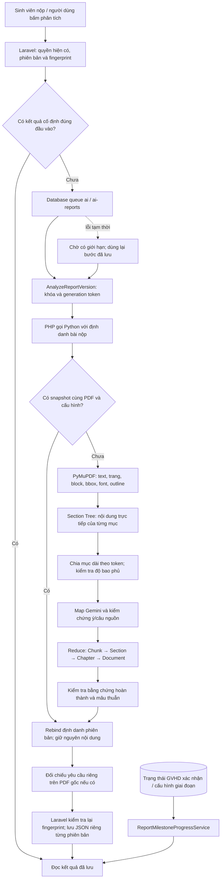

# Luồng tóm tắt báo cáo theo cấu trúc V6

Ngày triển khai: 24/10/2026. Áp dụng vào code local; không đổi `.env`, API key hoặc model; không pull/reset/push GitHub và không làm mới database.

## 1. Kết quả và phạm vi

Bản mới có ba phần AI: **Tổng quan tài liệu → Chương/mục thực tế → Công việc đã hoàn thành có bằng chứng**. Phần đối chiếu yêu cầu giảng viên vẫn độc lập. Tiến độ mốc báo cáo do Laravel tính, không do Gemini đánh giá.

Không tạo nhóm riêng cho khó khăn, kế hoạch, việc chưa làm hoặc phần trăm AI. Những nội dung đó vẫn được tóm tắt trong mục nguồn nếu PDF có trình bày. JSON V3–V5 vẫn đọc bằng nhánh tương thích; không xóa cột hoặc lịch sử bài nộp.

**Bổ sung yêu cầu nhất quán:** cùng PDF/cấu hình dùng bản tóm tắt đã kiểm chứng được lưu cố định. Nút Phân tích lại của cùng phiên bản, cùng yêu cầu và cấu hình không tạo thêm job/API khi đã có kết quả hoàn tất. Bản chưa hoàn tất tiếp tục các bước còn thiếu, không đóng băng kết quả rỗng hay lỗi.

## 2. Khảo sát trước khi sửa

Luồng đang chạy trên website là `AnalyzeReportVersion → AiSummaryService → app/Services/ai_summarizer.py`. Thư mục `ai_module/` là bản tham khảo cũ, không phải entry point website.

V5 đã có queue riêng, checkpoint, kiểm chứng câu trích, đối chiếu yêu cầu, generation token và popup PDF. Các thay đổi local về timeout và trích dẫn nhiều dòng được giữ lại. Những hạn chế được sửa:

- Chia mục bằng regex đơn giản, có thể nhầm mục lục/lời giới thiệu bố cục; số mục và tiêu đề tách thành hai khối khiến bỏ sót mục.
- Reduce chọn các nhóm chủ đề linh hoạt, chưa giữ đầy đủ cây chương/mục X.X và quan hệ cha/con.
- Khớp câu trích chưa đồng nghĩa câu nguồn chứng minh ý tóm tắt: cần thêm kiểm chứng ngữ nghĩa độc lập.
- Tiến độ trang giảng viên chia đều toàn bộ đợt; không đúng khi các giai đoạn có số đợt khác nhau.
- Một số trang xem báo cáo cũ còn gọi Python trực tiếp trong HTTP.
- Cache có TTL và bấm phân tích lại có thể gọi model sinh lại nội dung.

## 3. Kiến trúc thực tế



Sơ đồ hoạt động: [ai_document_summary_v6_activity.puml](ai_document_summary_v6_activity.puml).

## 4. Trích xuất, Section Tree và chunk

`pdf_layout_extraction.py` kiểm tra chữ ký PDF, mật khẩu, số trang (1–1.000), kích thước (50 MB ở Python; form hiện tại giới hạn 25 MB), lỗi mở tệp. Trích theo trang vật lý; mỗi dòng giữ bbox, cỡ/font, bold, block index. Đọc PDF outline làm tín hiệu bổ trợ.

OCR chỉ thử bằng PyMuPDF nếu có sẵn Tesseract và `TESSDATA_PREFIX`, tối đa 10 trang scan/lượt. Không cài thêm OCR nặng. Máy kiểm thử chưa có cấu hình OCR khả dụng; phần ảnh/sơ đồ/vector phức tạp hoặc scan chưa đọc được được ghi rõ, không dùng để kết luận thiếu yêu cầu. Trích được chữ trong sơ đồ không đồng nghĩa hiểu được quan hệ mũi tên/đồ họa.

`document_sections.py` kết hợp số mục, style, vị trí, khối văn bản và ngữ cảnh. Ghép số mục tách rời tiêu đề; hỗ trợ tiêu đề xuống dòng có tín hiệu cùng block/font. Lọc mục lục, dấu dẫn trang, header/footer lặp, số trang, caption và lời giới thiệu bố cục. Không tự sửa số chương bị thiếu trong báo cáo.

Node nội bộ có `id, number, title, level, parent_id, start_page, end_page, content, order_index, source_spans`. `content` chỉ thuộc trực tiếp node đó; con không bị sao chép vào nội dung nguồn của cha. Range của cha bao gồm range của con. Nếu không nhận diện cấu trúc, tạo đơn vị nguồn theo trang/vị trí, `number=null`, `kind=fallback`, `structure_fallback=true`; không gán số chương giả.

Thông số trong `config/ai_processing.php`: 2.500 token ước lượng/chunk, overlap 200, dự trữ hướng dẫn/metadata 1.500, ngân sách input 12.000. Ưu tiên ranh giới đoạn/câu; dòng dài vẫn bị chặn theo ngân sách. Mục ngắn không bị chia tùy tiện. Mỗi chunk mang document/version/chapter/section ID, chỉ số, trang và các source span chính xác. Nhãn trang chỉ chèn một lần khi đổi trang, không chèn vào từng dòng nguồn.

Kiểm tra bằng offset bảo đảm không mất ký tự nội dung hợp lệ và không giao cùng đoạn cho hai mục. Phần overlap được khử trùng ý và giữ các vị trí nguồn.

**Token:** chia local dùng `ceil(UTF8_bytes/3)` thận trọng, luôn ghi `conservative_utf8_estimate`, không gọi đây là tokenizer Gemini. Transport mặc định gọi `countTokens` của đúng model cho **toàn bộ prompt**, cache số đếm riêng và kiểm tra ngân sách trước `generateContent`. Dự trữ output 8.192 token khi điều tiết TPM; ghi `usageMetadata` thực tế của phản hồi, không gán số ước lượng thành số đo thật. Tham khảo [Google: đếm token](https://ai.google.dev/gemini-api/docs/tokens).

## 5. Map, kiểm chứng và tổng hợp phân cấp

1. Map trả các ý có `content`, loại ý, câu nguồn, trang và ID bất biến. Không nhận trang/câu nằm ngoài chunk.
2. Một lần kiểm chứng độc lập kiểm tra **toàn bộ ý**, gồm đối tượng, phủ định, điều kiện, thời điểm và mức chắc chắn. Ý không được nguồn chứng minh bị loại, lưu lý do; không biến thành “sinh viên chưa làm”. Audit nhiều ý được chia batch theo ngân sách.
3. Reduce chọn/ghép **ý đã kiểm chứng**, không được viết lại thành khẳng định mới không truy vết được. Mỗi mục luôn còn trong cây; lỗi một mục không xóa mục đó khỏi kết quả. Mục có nhiều chunk được tổng hợp lại đúng một mục. Cha nhận nội dung trực tiếp riêng và các tóm tắt con.
4. Với không quá 6 ý đầu vào, giữ toàn bộ; nhiều hơn chọn 6 ý đại diện, Reduce theo batch nhiều tầng khi cần. Việc rút gọn tổng quan không xóa các tóm tắt từng mục. Dùng tổng hợp mang tính trích chọn để giảm rủi ro diễn đạt thêm sự kiện.
5. Công việc hoàn thành phải là việc/kết quả tác giả báo cáo đã thực hiện, qua audit ngữ nghĩa và kiểm tra đủ ngữ cảnh câu. Đối chiếu tiếp với toàn bộ tập ý đã kiểm chứng theo các batch; mâu thuẫn chưa giải thích bị loại khỏi danh sách hoàn thành.
6. Bước/lượt lỗi được giữ dưới trạng thái partial; Map lỗi không được tính thành công. Trích đoạn local chỉ là phương án tham khảo có nhãn, không được nâng thành công việc hoàn thành.

Kiểm chứng bằng LLM vẫn có thể sai; trích dẫn giúp giảng viên kiểm tra và quyết định cuối cùng. Chưa có bộ đáp án gán nhãn đủ lớn để công bố precision/recall/F1 hoặc độ chính xác tổng quát.

## 6. Kết quả cố định và đúng phiên bản

- `_canonical_fingerprint` ở từng bài nộp gắn file SHA-256, document/version/group/topic/semester/stage/round, model, yêu cầu đợt và cấu hình xử lý. Bấm lại đúng fingerprint trả bản đã có, không enqueue.
- Snapshot tóm tắt riêng `canonical-summary-*.json` gắn PDF hash/model/cấu hình/phiên bản thuật toán. Không có TTL. Snapshot chỉ được ghi khi đọc/kiểm chứng văn bản và các Reduce/audit hoàn tất. Ảnh chưa đọc vẫn có cảnh báo riêng.
- Snapshot dùng chung chỉ chứa nội dung cùng PDF; loại thông tin nhóm/phiên bản trước khi lưu. Khi tái dùng, ràng buộc lại đúng bài nộp hiện tại. Đối chiếu yêu cầu nằm ngoài snapshot này, dùng cache theo đúng prompt yêu cầu.
- Các bước V6 thành công được giữ cố định theo hash/prompt/model/phiên bản. Bản ghi hợp lệ đầu tiên thắng khi có cạnh tranh ghi, dùng thư mục khóa ngắn và rename nguyên tử; không để phản hồi đến sau ghi đè.
- Thay PDF, model, cấu hình chunk hoặc `pipeline_version` tạo khóa xử lý khác. Chỉ đổi yêu cầu giảng viên có thể tái sử dụng bản tóm tắt cấu trúc nhưng cần đối chiếu lại.
- Cùng đầu vào, việc dùng lại dữ liệu đã lưu mới là cơ chế bảo đảm nhất quán; hạ temperature một mình không bảo đảm tính xác định từ dịch vụ bên ngoài.
- Tệp thay đổi thì UI không hiển thị bản tóm tắt cũ như thể thuộc tệp mới. Job kiểm tra fingerprint trước/sau; generation token chặn worker cũ ghi vào yêu cầu mới.
- Trước khi thay bản phân tích đã lưu, giữ snapshot lịch sử trong `storage/app/private/ai_history`; phiên bản bài nộp cũ và các cột cũ không bị xóa.

Nếu không lưu được checkpoint, có cảnh báo rõ. Database vẫn giữ kết quả cố định của phiên bản đã hoàn tất; cần sửa quyền ghi thư mục private để các phiên bản khác tái sử dụng snapshot ổn định. Không xóa cache/historical snapshot như một thao tác “sửa lỗi quota”.

## 7. JSON và tương thích

[Ví dụ từ Gemini thật trên PDF **giả lập**](ai_document_summary_v6_example.json). Định danh nghiệp vụ trong ví dụ đã thay bằng mã giả.

Các trường chính:

```json
{
  "schema_version": 6,
  "document_id": "bao_cao_id",
  "document_version_id": "phien_ban_id",
  "source_identity": {"group_id":"nhom", "topic_id":"de_tai", "semester_id":"hoc_ky", "source_hash":"sha256"},
  "analysis_status": "completed|partial",
  "overview_summary": "Tổng quan có nguồn",
  "chapters": [{"id":"S1", "number":"1", "title":"Tên chương", "items":[], "sections":[]}],
  "completed_work": [],
  "analysis_metadata": {"pages_total":0, "pages_analyzed":0, "sections_detected":0, "chunks_total":0, "chunks_succeeded":0, "chunks_failed":0, "structure_fallback":false}
}
```

Mỗi ý có `evidence`, `source_pages`, `source_ids`, `source_section_ids`, `verified`, `relevance_verified`. `overall_summary`/`document_content` giữ cho consumer hiện có. Bản mới không lưu `difficulties`, `next_steps`, `completion_percentage`, `completion_basis` trong JSON chuẩn. Các cột tương thích cũ được để rỗng khi không có dữ liệu mới tương ứng.

Không thêm migration: định danh bài nộp mới được gắn trong `_submission_identity` của JSON hiện có. Dữ liệu cũ chưa có nhóm chỉ được quy thuộc khi có duy nhất một đăng ký được duyệt cùng đề tài/học kỳ; trường hợp không rõ không tự tính vào tiến độ. Bảng `TomTatBaoCao` vẫn chỉ là snapshot tương thích theo báo cáo cha; JSON của từng `KhoiBaoCaoTienDo` là nguồn chính cho bản tóm tắt theo phiên bản.

## 8. Tiến độ nghiệp vụ

`ReportMilestoneProgressService` tính:

\[
w_i=100/N,\quad w_{ij}=100/(N\times M_i),\quad P=\sum_{i,j:\;confirmed_{ij}} w_{ij}
\]

`confirmed` yêu cầu phiên bản mới nhất của **đúng nhóm, đề tài, học kỳ, giai đoạn, đợt** có `TrangThai=Đạt`, người nhận xét và ngày nhận xét. Upload, tự đánh giá %, trạng thái đóng đợt hoặc phiên bản cũ từng đạt không tự tính là hoàn thành phiên bản mới. Không cộng nhiều phiên bản của cùng đợt.

Ví dụ 2 giai đoạn: giai đoạn A có 2 đợt, B có 4 đợt. Một đợt A đạt là 25%; hai đợt B đạt là 25%; tổng 50%, thay vì chia đều 3/6=50% một cách tình cờ. Nếu chỉ một đợt A đạt, kết quả đúng 25%, không phải 16,67%.

Không làm tròn trung gian; UI mới định dạng 2 số lẻ. Giai đoạn không có đợt đóng góp 0 và giữ nguyên phần trọng số chưa cấu hình. Không có giai đoạn: 0%, hiển thị chưa cấu hình. Thêm/bớt cấu hình hợp lệ tính lại theo cấu hình hiện tại. Luồng 6 bước nghiệp vụ toàn khóa luận trong `ThesisProgressService` được giữ riêng.

## 9. Kiểm thử và giới hạn

[Số liệu đã chạy](ai_document_summary_v6_checks.json) phân biệt dữ liệu giả lập, PDF thực tế và API thật. Bộ synthetic 3/20/80/160 trang kiểm tra cấu trúc, thứ tự, token và độ bao phủ; không phải benchmark độ chính xác model. PDF thật 62/72 trang dùng kiểm tra trích xuất/chia mục, không gửi hàng loạt lên Gemini.

Đã kiểm tra UI 390 và 1.440 px: mở/thu chương, mục con, popup lớn, popup trích dẫn lồng và cuộn; không tràn ngang toàn trang. Câu trích từ lượt Gemini thật được kiểm tra lại bằng bộ dựng PDF/highlight thật, không chỉ dựa vào endpoint giả lập giao diện.

Kiểm thử API thật dùng một PDF synthetic 3 trang trong database transaction, chạy bằng database queue riêng rồi rollback. Không lấy job từ queue người dùng. Có kiểm tra bấm lại cùng đầu vào không tạo job mới và JSON lưu không thay đổi. Các lượt thử có ngân sách nhỏ; số liệu chi tiết nằm trong JSON kiểm tra.

Giới hạn còn lại:

- Cấu trúc PDF là suy luận dựa trên bố cục; tài liệu thiếu tiêu đề, số mục trùng/sai hoặc nhiều cột có thể cần giảng viên đối chiếu cây mục. Không tuyên bố nhận diện mọi PDF chính xác.
- Chưa phân tích ý nghĩa ảnh/sơ đồ bằng mô hình thị giác. Scan cần OCR khả dụng; không gắn “thiếu yêu cầu” khi nguồn chưa đọc.
- Tổng quan thiên về ghép các ý đã xác minh, có thể ít mượt hơn một đoạn viết lại tự do; đổi lại truy vết được nguồn.
- Miễn phí vẫn có quota: cache giảm việc gọi lặp, không làm quota vô hạn. Máy nhiều worker/server cần bộ điều tiết quota dùng chung thay SQLite cục bộ.
- Chưa có đánh giá ngữ nghĩa trên tập PDF nhiều lĩnh vực đã gán nhãn. Thử nghiệm API thật nhỏ không chứng minh chất lượng chung trên hàng trăm trang.

## 10. Tệp thay đổi chính

| Tệp | Vai trò |
|---|---|
| `app/Services/pdf_layout_extraction.py` | Kiểm tra PDF, layout, OCR có sẵn |
| `app/Services/document_sections.py` | Section Tree, chunk theo token, kiểm tra coverage |
| `app/Services/ai_document_summary.py` | Map/audit/Reduce theo cây, công việc hoàn thành |
| `app/Services/ai_summary_snapshot.py` | Snapshot cố định, rebind đúng phiên bản |
| `app/Services/ai_summarizer.py` | CLI V6, vẫn giữ code đọc lịch sử |
| `app/Services/ai_processing.py`, `ai_gemini_transport.py` | Checkpoint cố định, quota, countTokens/usage |
| `app/Services/AiSummaryService.php`, `AiResultMerger.php` | Chuẩn hóa/lưu V6, bảo toàn kết quả và lịch sử |
| `app/Services/AiReportProcessingService.php`, `app/Jobs/AnalyzeReportVersion.php` | Fingerprint, giữ kết quả cố định, queue/generation guard |
| `app/Services/ReportMilestoneProgressService.php` | Tiến độ trọng số theo cấu hình, tách Gemini |
| `app/Services/ThesisProgressService.php` | Gắn định danh lúc nộp, phiên bản/file không trộn nhóm |
| `app/Http/Controllers/{GiangVien/DuyetBaoCaoController,SinhVien/BaoCaoController}.php` | Truyền tiến độ riêng, lọc bản nộp, enqueue khi đổi file |
| `resources/views/partials/{ai_summary_11_sections,ai_document_node,report_milestone_progress,ai_processing_status}.blade.php` | UI V6/legacy, trạng thái, trích dẫn |
| `resources/views/{giangvien,sinhvien}/baocao/show_dot.blade.php` | Khối tiến độ nghiệp vụ riêng |
| `config/ai_processing.php` | Ngân sách token và phiên bản thuật toán; không đổi model/key |

Các test mới: `test_document_sections.py`, `test_ai_document_summary.py`, `AiDocumentSummaryTest.php`, `ReportMilestoneProgressTest.php`, `ReportMilestoneProgressScopeTest.php`; mở rộng kiểm thử queue/recovery/quota và giữ các ca V5 tương thích.

## 11. Chạy và demo

1. Khi cập nhật code, nếu worker AI cũ đang mở, dừng rồi mở lại `CHAY_AI.bat` để PHP worker nạp lớp mới. Không chạy hai worker trên cùng máy.
2. Nộp PDF theo đợt hoặc bấm Phân tích lại trên bài có sẵn. Bài V3–V5 được giữ cho đến khi có kết quả V6 hợp lệ.
3. Khi đang chạy/chờ, xem tiến độ đọc và nguyên nhân. `Cập nhật kết quả mới` chỉ tải dữ liệu đã lưu.
4. Khi hoàn tất, mở chương/mục và bấm Trang để xem nguồn/tô sáng. Bấm Phân tích lại lần nữa: nhận thông báo dùng kết quả đã kiểm chứng, nội dung không đổi và không tạo job mới.
5. Để thử đầu vào khác, nộp phiên bản PDF khác hoặc đổi yêu cầu đợt theo nghiệp vụ. Tiến độ chỉ tăng sau khi GVHD xác nhận đạt phiên bản hiện tại.

Kiểm thử Python không gọi Gemini:

```powershell
python -B -X utf8 -m unittest discover -s tests/Unit -p 'test_*.py'
```

Kiểm thử PHP chọn tệp cụ thể, tránh tác động database thật bằng các test dùng làm mới database:

```powershell
php vendor/phpunit/phpunit/phpunit --no-configuration --do-not-cache-result tests/Unit/AiDocumentSummaryTest.php tests/Unit/ReportMilestoneProgressTest.php tests/Feature/AiReportQueueTest.php tests/Feature/ReportMilestoneProgressScopeTest.php
```

Feature test dùng `DatabaseTransactions`, rollback dữ liệu giả lập. Không chạy `migrate:fresh`, không xóa bài nộp hoặc cache để chạy test. Cấu hình PHP/Python thực tế và hướng xử lý quota xem [ai-processing-queue.md](../ai-processing-queue.md).
