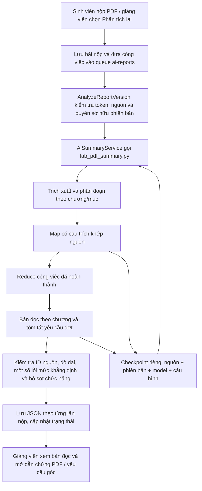

# Tích hợp PDF Segmentation Lab vào Laravel

Luồng PDF mặc định đã chuyển từ section-v6 sang **pdf-lab-v1.2**. Mã core và runtime được đóng gói trong `app/Services/pdf_lab`, có manifest SHA256 `UPSTREAM.json`. Không cần chạy Streamlit hoặc truy cập thư mục Lab. DOCX tiếp tục dùng bộ xử lý tài liệu cũ.

## Chạy

- Python 3.10+, cài `python -m pip install -r app/Services/pdf_lab/requirements.txt` vào Python được đặt ở `PYTHON_PATH`. Máy hiện tại đã có PyMuPDF 1.28.2.
- Dùng `GEMINI_API_KEY`, `GEMINI_MODEL` hiện có trong `.env`. Không đưa key vào tham số CLI, JSON, hoặc browser.
- Dùng `CHAY_DU_AN.bat` để mở web và worker; script không reset/seed database. Hoặc chạy `php artisan serve` và `php artisan ai:work` riêng. Worker dùng khóa để tránh chạy trùng.
- Cấu hình mới trong `config/ai_processing.php`: `pdf_engine=pdf_lab`, `lab.input_budget=8500`, `max_output_tokens=16384`, `max_generation_calls=5`, `pass_seconds=260`.
- Mỗi lượt worker có giới hạn; hết lượt thì tiếp tục từ checkpoint sau khoảng 1 giây. Quota/mạng giữ chính sách chờ; sai key hoặc đầu ra không đạt dừng để người dùng xem lỗi. Không báo hoàn tất từ kết quả bị cắt.

## Dữ liệu và tương thích

- Không thay đổi cấu trúc database. `KhoiBaoCaoTienDo.TomTatJson` giữ từng phiên bản; bảng tổng hợp cũ chỉ nhận snapshot của phiên bản mới nhất.
- Checkpoint chỉ ở `storage/app/private/ai_cache/pdf_lab`, ràng buộc hash PDF, phiên bản bài nộp/nhóm/đề tài, model, bộ đóng gói và ngân sách. Không dùng kết quả của bài nộp khác.
- Giữ hợp đồng hiển thị JSON v6, thêm `analysis.engine=pdf_lab`, `source_references`, `teacher_requirements`, `requirements_document`.
- Mỗi dẫn chứng mang câu trích riêng và trang riêng, dùng lại endpoint có kiểm tra quyền. Yêu cầu giảng viên lấy từ mô tả giai đoạn/đợt và yêu cầu nộp hiện tại, có bản nguồn để mở xem. Không tự chấm đạt/không đạt.
- Đổi mô tả yêu cầu làm đổi fingerprint; Map và bản đọc chương không thay đổi được dùng lại, yêu cầu đợt được tóm tắt lại. Có bảo vệ worker cũ ghi đè thế hệ mới.
- Kết quả cũ vẫn đọc được. Chọn **Phân tích lại** để tạo bản mới; hệ thống giữ lịch sử trước khi thay snapshot.

## Giới hạn

Chỉ xác nhận câu trích có trong text và một số quy tắc chất lượng cụ thể, không gọi đó là kiểm chứng ngữ nghĩa toàn diện. `semantic_audit_completed=false`; `quality_checks_completed` chỉ là các quy tắc của Lab. Hình/sơ đồ và các mục loại khỏi Map không nằm trong phạm vi text. Không hiển thị phần trăm chính xác do AI tự chấm. Số gói Map hoàn tất không đồng nghĩa đã hoàn tất Reduce và bản đọc.

## Kiểm tra tích hợp

- Python: `pytest tests/Unit/test_lab_pdf_bridge.py`: lưu/tiếp tục từ đĩa, thay brief dùng lại Map, tách phiên bản, key không vào checkpoint, thiếu key không tạo kết quả giả.
- PHP: `AiLabAdapterTest`: chọn script mới cho PDF, giữ DOCX cũ, truyền key bằng môi trường, giữ cấu trúc đầu ra và dẫn chứng, biên tập nguồn yêu cầu, phân biệt quota với hết ngân sách mỗi lượt.
- Giữ các kiểm thử `AiDocumentSummaryTest`, `AiSummaryIntegrityTest`, `AiQueuePolicyTest`, `AiReportQueueTest`, `ReportFileDownloadTest`. Không chạy `migrate:fresh` khi kiểm tra dữ liệu đang dùng.

## Kết quả kiểm chứng trên máy hiện tại — 26/10/2026

- 18/18 file core/runtime vendored khớp SHA256 với mã Lab đã kiểm thử.
- 8 kiểm thử Python của lớp nối đạt. 41 kiểm thử PHP liên quan đã chạy: 39 đạt, 2 kiểm thử tải tệp bỏ qua vì `is_readable` trong sandbox Windows; việc tải PDF thật đã kiểm tra thành công trên browser.
- Lượt thật PHP → Python → Gemini trên PDF mẫu 6 trang hoàn tất qua 2 lượt worker-budget, có bản đọc, dẫn chứng và tóm tắt yêu cầu đợt.
- Người dùng bấm Phân tích lại ở N12, đợt 129, phiên bản v1 `KHOI_D129_V1_6f1098`. Kết quả đã lưu vào database: `analysis.engine=pdf_lab`, 23/23 Map, 8 phần (Mở đầu, 6 chương, Kết luận), 4 công việc, 2 ý yêu cầu đợt, trạng thái completed và canonical fingerprint.
- Đã mở dẫn chứng chương 5 tại trang 120/124: PDF hiển thị và câu nguồn được tô vàng. Đã mở yêu cầu gốc của đợt, giữ điều kiện chưa yêu cầu cài đặt/mã nguồn/kiểm thử.
- Kiểm tra enqueue lại cùng đầu vào: reused=true, số job tăng 0, payload không đổi; không gọi AI sinh lại.
- Đã gia cố ghi checkpoint khi gặp lỗi chia sẻ tệp Windows và cho phép tệp tiến độ hiển thị bị bận mà không làm ngắt phân tích. Lỗi không nhận diện được được xếp vào lỗi dịch vụ có thể tiếp tục, thay vì lẫn với lỗi đầu ra/cấu hình cần dừng.
- Đã sửa giới hạn 420 giây từ service cũ làm chết worker CLI kể cả khi chờ việc: worker CLI không đặt deadline toàn tiến trình; giới hạn subprocess 360 giây, job 390 giây và ngân sách lượt Python vẫn giữ.
- File khởi động cũ có `migrate:fresh --seed --force`; đã thay bằng khởi động web/worker và giữ dữ liệu. Bản trước sửa được lưu trong workspace của cuộc hội thoại.

Chưa triển khai OCR/hình hoặc đánh giá ngữ nghĩa toàn diện. Không tự quyết định đạt/không đạt, không tự chấm điểm sinh viên. Chưa chạy toàn bộ bộ kiểm thử ứng dụng không liên quan đến AI. Không commit những thay đổi có sẵn khác trong working tree.

## Cập nhật guard TODO/TBD v1.3 - 26/10/2026

- Đồng bộ claim_guards.py, summarizer.py, checkpoints.py từ Lab; cập nhật manifest SHA256. Summary runtime gemini-summary-1.3; ENGINE_VERSION và pipeline_version pdf-lab-v1.3 để không lấy nhầm kết quả cũ khi phân tích lại. Chưa thay đổi dữ liệu bài nộp có sẵn.
- Lượt chạy Gemini thật mới trên 01_Quan ly do an_v4.pdf (124 trang), gemini-3.5-flash-lite: 23/23 Map, Reduce và bản đọc complete; 8 phần (Mở đầu, 6 chương, Kết luận), 4 công việc tổng hợp. 141 câu trích MATCH; 7 câu không khớp bị loại. Các reference dùng ở kết quả cuối khớp offset nguồn. 26 lần generate cho Map/Reduce + 11 cho bản đọc; 468.7 giây (~7 phút 49 giây). Không gặp lỗi quota/mạng trong lượt này; thời gian này không phải SLA hoặc trung bình nhiều lần.
- Mang checkpoint thật qua run_pipeline project bằng cache kiểm thử riêng trong workspace: completed, 23 gói, 8 phần; không gọi API mới. Không ghi đè kết quả N12 hoặc bài nộp khác trong DB.
- Test project sau đồng bộ: 16 Python bridge pass; 35 PHP test pass (125 assertions). Bổ sung kiểm thử 6 dòng bẫy quan sát được, nội dung chương vẫn được giữ khi work bị loại, tách disk cache theo phiên bản engine. 18/18 file trong manifest khớp Lab.
- Đã config:clear và khởi động lại worker AI khi hàng đợi không có job.
- Ghi chú chất lượng: một câu chương 1 nói “ba nhóm” nhưng liệt kê năm vai trò. Đây là điểm diễn đạt/suy luận chưa nhất quán của LLM, không phải lỗi xử lý TODO/TBD; không xác nhận đầu ra đúng ngữ nghĩa tuyệt đối. Giữ bản gốc để người dùng đánh giá, chưa tự sửa kết quả AI hoặc dữ liệu bài nộp.
- Tóm tắt tiếp tục dùng text; ảnh/sơ đồ để giảng viên đối chiếu. Toàn bộ mã và artefact trước đồng bộ đã được sao lưu trong work/project-before-todo-v13 của workspace.

## Kiểm thử UI N12 trực tiếp sau tích hợp v1.3

- Đã bấm Phân tích lại trên phiên giảng viên ở /giangvien/tiendo/dot-nop/129, báo cáo KHOI_D129_V1_6f1098, không thông qua dữ liệu giả lập.
- Job được enqueue, worker xử lý LLM thật qua nhiều lượt, Map tiến tới đủ 23/23. Trong lần đầu reader gặp reader_too_long: bản nháp chương 2 có 198 từ và một lần biên tập vẫn quá dài; hệ thống dừng partial đúng thiết kế, giữ Map và các kết quả hợp lệ.
- Đã bổ sung tối đa một lần rút gọn cuối (60-80 từ mục tiêu, dưới 120 từ theo prompt), giữ validator giới hạn 180 từ, IDs và kiểm tra chất lượng. Tối đa 2 lần biên tập sau nháp, không retry không giới hạn; quota/network vẫn dừng theo chính sách cũ. Áp dụng cùng mã cho Lab và runtime vendored, cập nhật SHA256 manifest.
- Bấm tiếp tục qua Phân tích lại, dùng lại Map/Reduce và yêu cầu đã lưu. Kết quả cuối completed, pdf-lab-v1.3, 23/23 gói, 8 vùng chương/phần, 6 công việc, 6 yêu cầu đợt, canonical/source fingerprint khớp, không còn lỗi, hàng đợi 0.
- 7 vùng có bản đọc (Mở đầu + chương 1-6), tất cả dưới 180 từ. Vùng Kết luận không có câu trích MATCH được chấp nhận ở lượt này, UI ghi rõ chưa trích được ý có bằng chứng. Không biến việc xử lý đủ Map thành cam kết đầy đủ ngữ nghĩa.
- Đã kiểm tra 76 lượt tham chiếu trong output cuối: offset, câu nguồn và trang đều khớp. Mở trên UI chương 5, nguồn trang 91/124 tải PDF và tô vàng đúng câu. Nguồn yêu cầu đợt mở được nguyên văn.
- Bấm Phân tích lại lần kế tiếp sau complete: payload hash không đổi, generation_attempts không tăng, không tạo job mới.
- Sửa thông báo UI: phân biệt bản đã lưu khi đang phân tích lại; hết ngân sách mỗi lượt ghi rõ tự tiếp tục; bộ đếm Map khi tiếp tục lấy số gói đã lưu thay vì reset 0. Test bổ sung cho các trường hợp này.
- Kiểm thử sau sửa: Lab 205 passed, 2 skipped; bridge project 18 passed; PHP liên quan 36 passed, 142 assertions.
- Bản trước test và payload cuối, audit cache, câu trích, ảnh trang 91 được lưu trong outputs/n12-v13-* của workspace. Không thay đổi đánh giá/đạt/chưa đạt, nhận xét chuyên môn hoặc thời hạn đợt nộp.

## Dẫn chứng báo cáo theo từng yêu cầu giảng viên - 26/10/2026

Đã bổ sung requirement-links-1.1 trong runtime dùng chung và gọi sau khi reader hoàn tất. Mỗi yêu cầu đã tóm tắt được gắn mã R0001..., truy hồi tối đa 10 câu Map có quote MATCH và offset khớp PDF hiện tại; LLM lựa chọn đoạn liên quan trong danh sách đó. JSON schema ràng buộc enum ID riêng từng yêu cầu, validator kiểm tra đầy đủ số yêu cầu, IDs, số nguồn và trạng thái. Không tự chấm đạt/chưa đạt hoặc tính điểm.

- related_text: có nội dung liên quan để giảng viên kiểm tra, không đồng nghĩa triển khai/hoàn thành.
- not_found: chưa tìm được trong tập câu nguồn đã đối chiếu, không khẳng định PDF không có nội dung.
- scope_note: điều kiện/phạm vi của đợt như chưa yêu cầu mã nguồn; không tìm bằng chứng thực hiện một yêu cầu không được giao.

Checkpoint riêng requirement_links.json; identity gắn hash PDF, Map, yêu cầu gốc, model, ngân sách và version của linker. Giữ cache Map/reader hiện tại để tránh tóm tắt lại toàn báo cáo. PHP pipeline_version pdf-lab-v1.4-requirement-links để kết quả cũ phải bổ sung bước này trước khi được dùng lại như bản đầy đủ. ENGINE_VERSION lõi vẫn v1.3 để giữ binding checkpoint. Không đổi schema DB. requirements_review giữ trạng thái not_configured (cơ chế chấm không cấu hình), thêm mode=source_links_only; trạng thái hoàn tất nối nguồn ở requirements_links_status riêng.

Giao diện Yêu cầu giảng viên theo đợt có Xem yêu cầu gốc, Đoạn liên quan trong báo cáo, giải thích, loại nội dung, từng câu trích và nút Trang. Tất cả nội dung được escape. Thiếu nguồn hiển thị rõ; giữ nguyên nút trích dẫn PDF kiểm tra quyền và tô vàng.

Thực nghiệm N12: 6 ý yêu cầu, 5 related_text + 1 scope_note. 13 tham chiếu đều khớp offset văn bản nguồn. Ví dụ yêu cầu quản lý/đăng ký đề tài nối trang 29,71,72. Đã bấm từ yêu cầu đó sang trang PDF 72/124 và xác nhận tô vàng mô tả đăng ký. Lượt nối thành công dùng 2 generation; Map 28 và reader 12 generation trước đó không tăng. Trong khi phát triển đã chặn một đầu ra ID ngoài danh sách và siết schema trước khi chấp nhận. Không dùng đầu ra bị từ chối trong UI.

Sau lưu: processing completed, source/canonical fingerprint khớp; bấm Phân tích lại cùng đầu vào không tạo job, không tăng các bộ đếm Map/reader/link, payload hash không đổi. Không thay đổi kết quả đánh giá chuyên môn, quyền, hạn nộp hoặc điểm của sinh viên.

Giới hạn: chỉ truy hồi trong các câu Map đã trích và kiểm tra, tối đa 10 ứng viên mỗi yêu cầu; có thể bỏ sót đoạn trong PDF, do vậy không dùng not_found để chấm không đạt. Chưa đọc ảnh, và quote MATCH chưa chứng minh ngữ nghĩa đầy đủ.

Bản sao trước sửa: work/before-requirement-links trong workspace. Bằng chứng: outputs/n12-requirement-links-final-payload.json, *source-audit.json, *final-audit.json, *after-cache-audit.json, ảnh n12-requirement-link-page72.png.

Kiểm thử cuối: Lab 211 passed, 2 skipped; Python bridge 18 passed; PHP 37 passed (148 assertions). Bản chạy thật N12 đã lưu và kiểm tra cache trên UI.

